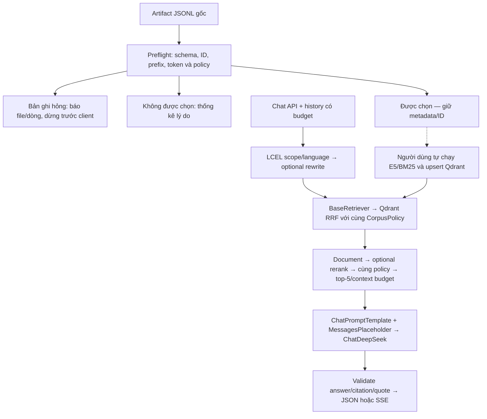

# IndexBeast: LangChain và corpus thử nghiệm

TV3 — MinhMuc, nhóm 4 Hollows. Cập nhật 29/10/2026.

Đo full re-embedding/upsert ngày 30/10/2026: 18.368 chunk EN, **999,802 giây** cho index,
**1.009,263 giây** kể cả preflight/xác minh. Xem [benchmark trọn lượt](../../../docs/testing/2026-10-30_full-index-benchmark.md).
Đây là chạy lại trên collection đã có; không cần index lần nữa chỉ để demo.

Quyết định mới của team: trợ lý Elden Ring hỗ trợ lore, gameplay, quest, trang bị, boss và gợi ý build,
gồm DLC và nội dung liên quan trong corpus. Không từ chối chỉ vì câu hỏi thuộc gameplay/build.
Giữ metadata game/release/continuity và độ chưa chắc chắn; không tự coi mọi nguồn là cùng canon.
Admission kỹ thuật cho phép thử nghiệm trước khi thẩm định toàn bộ, không phải xác minh lore.

**Cập nhật phạm vi đa mục đích:** xem [audit dữ liệu, thay đổi code và 10 câu thử](../../../docs/testing/2026-10-29_elden-ring-assistant-capabilities.md).
Corpus hiện có cơ chế/notes hữu ích nhưng đã lọc nhiều bảng stat, acquisition và combat. Không hứa build tối ưu
hoặc walkthrough toàn diện. Collection hiện tại dùng tiếp, không cần reindex cho thay đổi prompt/gate.

## Trạng thái và luồng xử lý

- `CHAT_MODE=mock` vẫn là mặc định. `llm_only` dùng ChatDeepSeek, không tạo encoder/retriever/reranker/Qdrant client cho chat.
- `rag` dùng LCEL, async BaseRetriever/Document, E5 ONNX + BM25, Qdrant RRF và context tối đa 5 chunk.
- Lượt triển khai đầu chỉ kiểm offline. Sau đó người dùng cho phép sửa `.env`, chạy embedding/index và DeepSeek thật.
  Xem [báo cáo tích hợp ngày 29/10](../../../docs/testing/2026-10-29_rag-integration-report.md), gồm cả lỗi đã phát hiện.
- API JSON/SSE/conversation/feedback giữ nguyên. Kiểm thử thật là smoke test, chưa thay benchmark chất lượng độc lập.
- Không thêm dependency hoặc LangGraph; giữ `langchain-core==1.7.1`, `langchain-deepseek==1.1.1`,
  `fastembed==0.9.0`, `qdrant-client==1.19.1` và constraints hiện có.



## Artifact và dry-run thực tế

Nguồn: `backend/data/chunk_runs/s2-full-v1/chunks.jsonl`.
Đọc [manifest bàn giao](../../data/delivery/s2-full/manifest.json) và report cùng thư mục để truy xuất nguồn gốc.
Không thay JSONL bằng CSV: CSV chỉ giữ 18/37 trường của artifact này.

Đã chạy CLI dry-run với policy `pilot`, ngôn ngữ `en`, kiểm token bằng tokenizer E5 local:

| Chỉ số | Kết quả |
|---|---:|
| Tổng bản ghi | 23.765 |
| Được chọn | 18.368 |
| Không được chọn | 5.397 |
| Lý do không chọn | `language_not_selected` |
| Bản ghi hỏng | 0 |

SHA-256 input: `95794a89485e6f86ff320ee9b2a9a707a794e1bdc040162f0b41e5b2c208d03e`.
SHA-256 tokenizer: `0b44a9d7b51c3c62626640cda0e2c2f70fdacdc25bbbd68038369d14ebdf4c39`.
Token được kiểm lại trên toàn bộ artifact, kể cả bản ghi không được chọn; không chạy embedding.
Đã chạy thêm dry-run với guard chặn constructor encoder/LLM/HTTP/Qdrant/DB/Redis và socket connect;
guard đạt, hash artifact trước/sau giữ nguyên. Không tạo client/model hoặc mở kết nối trong dry-run.
Đây không phải kết quả index, trạng thái server hoặc đánh giá semantic correctness.

## Policy dùng chung

[core/corpus.py](../../core/corpus.py) dùng chung cho indexing, query filters và chọn context.
Settings/factory truyền cùng mode/ngôn ngữ tới QdrantStore và ChatPipeline; constructor từ chối mismatch.
Helper cấp thấp mặc định `reviewed` để tương thích caller cũ; application Settings mặc định `pilot/en`.

| Policy | Điều kiện |
|---|---|
| `pilot` | Game scope `elden_ring` hoặc `base`, loại nguồn được hỗ trợ, ngôn ngữ được chọn; không đòi approval giả |
| `reviewed` | Policy cũ: `base` + `review_status=approved`, không scope review/excluded; vẫn chọn ngôn ngữ rõ ràng |

Pilot giữ nguyên `review_status`, `release_scope` và metadata gốc, kể cả khi thiếu/unknown/candidate.
`review_status=review` là tình trạng thẩm định, không tự biến thành approved.
`decision=review/excluded`, `chunk_eligible=false` và `review_status=rejected/excluded` vẫn không được chọn.
`scope_status=review/excluded` chỉ được xét lại khi có reason thuộc allowlist scope-only cũ:
`explicit_dlc_lead_definition`, `mixed_or_dlc_page_context`, `dlc_or_mixed_marker_in_content`,
`entity_from_explicit_dlc_or_mixed_sample`, `no_positive_scope_evidence`, `no_positive_base_evidence`,
hoặc prefix `explicit_dlc_heading:`. Lý do cấu trúc, cut/unused, ngoài phạm vi khác hoặc không rõ không tự được phục hồi.
Không lấy lại section đã bị loại khỏi JSONL hoặc nhập `review.jsonl` vào corpus.

Payload Qdrant thêm `indexbeast_admission=pilot-v1` (hoặc `reviewed-v1`): chỉ là dấu vận hành của policy,
không phải nhãn đáng tin hay approval. Trùng tên metadata reserved bị báo lỗi, không ghi đè nguồn.
Pilot query đòi stamp đúng, game, language và source_type ở cả prefetch/fusion; sau retrieval và trước
chọn context vẫn kiểm policy đầy đủ. Point từ pipeline khác/không có stamp không tự lọt vào pilot.
Filter preselect không thay thế post-validation; chưa hứa recall hoàn hảo khi ứng viên bị loại sau fusion.

Supported source types: `in_game_text`, `wiki_prose`, `speculation`. Nhãn unknown/khác được thống kê là
không được chọn, không sửa nhãn. Ngôn ngữ mặc định `en`; có thể chọn `en,ja` hoặc tập tường minh khác.
`unknown` chỉ được chọn nếu chủ động chỉ định chính nhãn đó, không bao giờ đổi thành `en`.

Spoiler: thiếu/null nhãn không được coi là an toàn. `spoilers=false` chỉ nhận `spoiler_level=0`;
corpus hiện thiếu trường này nên có thể trả thiếu bằng chứng. Dùng `spoilers=true` khi tự thử baseline,
không gán 0 hàng loạt vào dữ liệu.

## Cấu hình

Ví dụ khởi đầu cho máy mới; giữ nguyên key và mật khẩu. Máy hiện tại đã được cập nhật `.env` theo yêu cầu người dùng:

```dotenv
CHAT_MODE=mock
RAG_CORPUS_POLICY=pilot
RAG_LANGUAGES=en
RAG_COLLECTION=lore_pilot_v1
```

`lore_pilot_v1` là tên đề xuất cho lượt thử riêng; mặc định Settings vẫn là `lore_chunks` để không tự đổi
collection hiện có. CLI override không sửa `.env`; index/retrieval/API cần cùng policy, ngôn ngữ và collection.
Docker Compose đã truyền hai biến mới; đổi env cần recreate service API.

Biến giữ nguyên: `RAG_PREFETCH=30`, `RAG_TOP_K=5`, `RAG_CONTEXT_CHARS=12000`,
`RAG_REWRITE_ENABLED=false`, `RAG_MODELS_DIR=models/fastembed`, `RAG_BATCH_SIZE=32`,
`CHAT_HISTORY_MESSAGES=8`, `CHAT_HISTORY_CHARS=8000` và cấu hình `LLM_*`/DeepSeek hiện có.
Model lấy từ Settings, không thay tên model theo ví dụ. Rewrite bật sẽ thêm lượt gọi model thật.
`RAG_ENCODER_THREADS=2` là mặc định code (giới hạn 1–32); máy thử dùng 4 thread, batch 8 và cache
`models/notebook-fastembed`. `RAG_THINKING_ENABLED=false` mặc định; máy thử bật `true` sau khi phát hiện
non-thinking có lỗi JSON/citation. Flag chỉ bật thinking cho generation RAG, không đổi llm_only/dev test.
Thinking có thể tăng token/độ trễ; private reasoning không được gửi qua chat/SSE hoặc lưu báo cáo.
Lượt kiểm thử cuối dùng `LLM_MAX_TOKENS=4096`; budget ảnh hưởng cả chi phí và khả năng hoàn tất JSON.

## Tự chạy preflight — không model/client/network

Từ **backend/**, dùng PowerShell. Đây cũng là dạng lệnh dry-run đã được thực thi:

```powershell
$artifact = 'data/chunk_runs/s2-full-v1/chunks.jsonl'
$tokenizer = 'models/notebook-fastembed/models--intfloat--multilingual-e5-small/snapshots/614241f622f53c4eeff9890bdc4f31cfecc418b3/tokenizer.json'
.venv/Scripts/python.exe -X utf8 -m ingest index --input $artifact --policy pilot --languages en --collection lore_pilot_v1 --tokenizer $tokenizer --dry-run
```

Tokenizer path trên có sẵn ở máy hiện tại. Máy khác cần trỏ tới tokenizer E5 local của mình; lệnh không tự tải.
Bỏ `--tokenizer` thì chỉ kiểm kiểu/giới hạn token_count khai báo và báo `declared_bounds_only`, không được
diễn giải là đã re-encode. Khi có tokenizer, kiểm số token thực và khớp token_count; không truncate.

Report chứa hash input, tổng, accepted, invalid, excluded, phân bố ngôn ngữ/release và lý do.
Invalid luôn kèm file/dòng và chi tiết lỗi schema; có bất kỳ invalid hoặc không có bản ghi được chọn thì
exit 2, dừng trước client. Không được chọn do policy/ngôn ngữ không làm hỏng toàn bộ lượt chạy, có thống kê rõ.
Phân bố metadata lấy từ bản ghi hợp lệ về schema/ID/token; lỗi được báo riêng.
Mặc định in 10 ví dụ excluded; thêm `--details` để xem tất cả vị trí. Blank line, JSON lỗi/trùng key,
encoding lỗi và duplicate ID đều là invalid. Kiểm ID trùng cả ở bản ghi không được chọn.
Không in toàn bộ nội dung nguồn hoặc secret trong lỗi validation.

Parser giữ các lệnh `crawl/survey/report/clean/chunk/index`. Argument bị mất lúc merge trước đã được
khôi phục khi rebase chuẩn bị. Tác vụ này thêm policy/languages/collection/details và preflight mới,
không thay thuật toán clean/chunk của TV2.

## Tái lập embedding/index thật

**Các lệnh này chạy CPU inference và ghi Qdrant, có thể tải model nếu cache thiếu.** Lượt tích hợp đã nạp
18.368 point vào collection thử nghiệm riêng; không cần chạy lại index chỉ để chat với collection đã nạp.

Từ gốc repo có thể bật Qdrant: `docker compose up -d --wait qdrant`. Sau đó từ backend, dùng các biến
`$artifact`, `$tokenizer` ở trên, chạy cùng lệnh nhưng bỏ `--dry-run`:

```powershell
.venv/Scripts/python.exe -X utf8 -m ingest index --input $artifact --policy pilot --languages en --collection lore_pilot_v1 --tokenizer $tokenizer
```

Model FastEmbed: `intfloat/multilingual-e5-small`, ONNX mean pooling/normalization, dense 384 cosine;
sparse `Qdrant/bm25`, IDF; Qdrant fusion RRF. Không có splitter mới hoặc embedding ảnh.
Encoder thêm prefix đúng một lần, kiểm tokenizer thật trước inference; load/inference trong thread với
lock bảo vệ tái sử dụng/cancellation. Không load model lúc import, mock hoặc llm_only.

Preflight toàn file xong trước client/model. Batch upsert dùng ID ổn định; chạy lại cùng input không tăng
số point. Kiểm schema và payload indexes, không drop/recreate collection không tương thích.
Không có transaction xuyên batch: lỗi giữa chừng có thể đã ghi batch trước đó. Chưa tự xóa point cũ khi
artifact đổi nội dung, ordinal hoặc tập lựa chọn. Nên dùng collection thử nghiệm mới khi đổi corpus/policy lớn.
Không xác nhận model/server thật hoạt động chỉ từ unit test offline.

## Tự kiểm retrieval, chưa gọi LLM

Đặt `.env` cùng policy/lang/collection đã index. Các lệnh sau **embed query và đọc Qdrant thật**,
có thể tải model nếu cache thiếu. Lượt tích hợp đã kiểm retrieval thật; các lệnh sau cho phép tái hiện riêng:

```powershell
.venv/Scripts/python.exe -X utf8 -m scripts.check_retrieval --query 'Who is Ranni?' --limit 5
.venv/Scripts/python.exe -X utf8 -m scripts.check_retrieval --query 'Ranni là ai?' --limit 5
```

Diagnostic dùng HybridRetriever, in point/artifact ID, score, nguồn, release/lang/review và excerpt.
Không gọi DeepSeek hoặc ghi index. Thêm `--no-spoilers` để kiểm hành vi nhãn an toàn; thiếu nhãn sẽ không được lấy.
RRF score không phải xác suất đáp án đúng; chưa chốt threshold hoặc benchmark reranker.
Nếu không có kết quả, kiểm collection, policy stamp, ngôn ngữ, spoiler và corpus trước khi kết luận model lỗi.

## Tự bật API RAG / llm_only — có gọi DeepSeek và dùng credits

Sau khi index và kiểm retrieval, tự đặt `CHAT_MODE=rag` trong `.env` rồi restart API.
Giữ `RAG_CORPUS_POLICY=pilot`, `RAG_LANGUAGES=en`, `RAG_COLLECTION=lore_pilot_v1` cho ví dụ trên.
Từ backend, dùng PowerShell:

```powershell
$apiPort = & .venv/Scripts/python.exe -c "from dotenv import dotenv_values; print(dotenv_values('../.env')['API_PORT'])"
.venv/Scripts/python.exe -m uvicorn --factory app.main:create_app --reload --host 127.0.0.1 --port $apiPort --no-access-log
```

Swagger ở `/api/docs`, thử `POST /api/v1/chat` hoặc `/api/v1/chat/stream`:

```json
{
  "message": "Ranni là ai? Nêu rõ nếu dùng thông tin từ bản mở rộng.",
  "channel": "web",
  "options": {"lang": "vi", "spoilers": true}
}
```

Nếu chưa muốn index, dùng `CHAT_MODE=llm_only` với key DeepSeek Platform hiện có. Mode này không retrieval,
`sources=[]`, `grounded=false`, có nhãn chưa đối chiếu corpus. Không fallback giữa mode hoặc sang mock khi lỗi.
App vẫn có health probes PostgreSQL/Redis/Qdrant; `/health` có thể 503 khi chúng tắt. Riêng llm_only chat
không tạo Qdrant client; chỉ explicit health probe mới tạo client riêng, tái sử dụng và đóng lúc shutdown.

## ID, context và contract ứng dụng

Giữ mapping `artifact-point-v1` đang có, không đổi thuật toán của TV1/TV2:

- `document_id` canonical lấy từ `core.ids.document_id(source, source_id)`.
- Bộ full hiện tại có artifact `doc_id` khớp canonical ID và `chunk_id=uuid5(doc_id, ordinal)`.
- Qdrant point UUID vẫn là uuid5(namespace, `artifact-point-v1:{document_id}:{artifact_chunk_id}`).
- Payload giữ `doc_id`, `chunk_id`, `ordinal`, `artifact_chunk_id`, canonical `document_id`, metadata nguồn.
  Không dùng point UUID giả làm PostgreSQL chunk UUID. Bước này không ghi PostgreSQL hoặc cập nhật liên kết DB.

Older artifact có thể dùng chunk hash khác; không tính lại ID. Không renumber ordinal sau chọn ngôn ngữ.
`Hit ↔ Document` dùng page_content=text, metadata namespaced chứa toàn bộ payload và deep copy;
source, revision, timestamps, trigger/variant/image association và metadata bổ sung giữ nguyên.

Context model có point ID riêng với artifact chunk ID, game/release/continuity, source/source_type/evidence,
lang, review_status và admission_policy khi có. Unknown/null được cung cấp giữ nguyên; trường vắng không tự thêm.
Không nâng candidate thành verified. Prompt yêu cầu ưu tiên đúng release, chỉ mô tả quan hệ có bằng chứng,
không gộp canon theo co-retrieval. Release còn là candidate, chưa phải filter release được xác minh.
Không dùng history làm evidence.

Giữ ChatPromptTemplate + MessagesPlaceholder đúng role; rewrite JSON có Pydantic validation/fallback câu gốc;
NoReranker giữ thứ tự, chưa tự tải reranker. Context có budget ký tự riêng, giữ chunk nguyên vẹn, tối đa top-5.
ChatDeepSeek/client dùng lifespan; usage thiếu là null, không bịa 0. Remote tracing tắt tại entry points.
Prompt phân biệt [persona](prompts/persona.md), [llm_only](prompts/llm_only.md),
[answer](prompts/answer.md) và [rewrite](prompts/rewrite.md).

Validation yêu cầu citation khớp index/evidence, quote nguyên văn, URL/title từ metadata server,
chỉ trả nguồn thực sự trích. Đây là kiểm grounding hình thức, không phải entailment judge.
Với partial answer, model có thể thêm field nội bộ `limitation` (tối đa 1.000 ký tự): chỉ nêu thiếu dữ liệu
hoặc câu hỏi làm rõ, không có facts mới/citation/URL. Backend kiểm rồi nối cuối answer; không đổi API v1.
Phần answer có facts vẫn cần citation mỗi đoạn; không ép citation không liên quan vào đoạn thiếu dữ liệu.
`grounded=true` không khẳng định mọi phần câu hỏi đã được giải đáp; limitation vẫn cần review ngữ nghĩa.
Context bổ sung evidence units có ID: model chọn `quote_id`, backend trích nguyên văn từ chunk đã chọn
và kiểm citation/evidence-set như cũ. Quote literal vẫn được hỗ trợ; ID không tồn tại bị từ chối.
Đoạn dài được chia thành các phần evidence giới hạn 2.000 ký tự để chọn quote, không chia lại chunk/index.
SSE dùng streaming thật, prime trước headers, giữ cancellation/cleanup; lỗi giữa stream hoặc validation cuối
thất bại trả error, không done thành công. Không gửi evidence JSON hoặc private reasoning trong chat/SSE.
API JSON/SSE/conversation/feedback không đổi; dev endpoint giữ contract reasoning riêng, không log.
History/feedback live vẫn là RAM, có giới hạn hội thoại/trace, chưa phải persistence production hoặc xác thực.

## Kiểm thử và phần cần đồng bộ riêng

Từ backend, chỉ unit/offline:

```powershell
.venv/Scripts/python.exe -X utf8 -m pytest -c pyproject.toml tests/unit -q
.venv/Scripts/python.exe -m ruff check .
.venv/Scripts/python.exe -m ruff format --check .
.venv/Scripts/python.exe -X utf8 -m scripts.export_openapi --check
.venv/Scripts/python.exe -m pip check
```

Baseline triển khai: **201 unit test đạt**; sau policy corpus: **242**; sau tuning và regression từ kiểm thử thật: **259**.
Sau mở rộng trợ lý gameplay/build: **284 unit test đạt**, chỉ kiểm offline trong lượt mở rộng;
kết quả live cũ không chứng minh chất lượng gameplay của prompt mới.
Ruff check, format, OpenAPI check, `pip check` và `git diff --check` được kiểm cùng quy trình trên.
Có một warning dự kiến: Qdrant memory không thực thi payload indexes như server.
Test mới bao gồm policy pilot/reviewed, ngôn ngữ, lỗi có vị trí, token local, reserved metadata,
duplicate ID cả ở dòng không được chọn, CLI cũ, ngăn side effect khi preflight lỗi,
idempotency/RRF/metadata, spoiler unknown, scope/prompt mới và cleanup của diagnostic retrieval giả.
Assertion nghiệp vụ cũ giữ nguyên; không sửa expected để che regression budget/context.
Test không đo chất lượng trên corpus thật. Không chạy pytest từ gốc repo để tránh collect integration/route test_llm.

File chính: [CorpusPolicy](../../core/corpus.py), [index/preflight](../../ingest/indexing.py),
[CLI](../../ingest/__main__.py), [QdrantStore](../../core/vector/store.py), [pipeline](pipeline.py),
[factory](../services/factory.py), [retrieval diagnostic](../../scripts/check_retrieval.py),
[tests pilot](../../tests/unit/test_corpus_pilot.py). Settings/.env.example/Compose đồng bộ biến mới.

Chưa sửa `docs/02_SRS.md`, `docs/adr/004-base-game-scope.md`: còn mô tả phạm vi cũ, nhóm cần ghi quyết định mới
theo quy trình yêu cầu. Đối chiếu thêm ADR-003, kiến trúc, techstack và planning với version full/ID thực tế.
Handover lịch sử phản ánh các lượt cũ, không thay report hiện tại. Chunker trong repo vẫn nhận `s2-clean-2.0`
và sinh `s2-chunk-1.0`; artifact bàn giao dùng `s2-full-*`. Adapter đọc artifact có sẵn, chưa tự nhận tái lập
được workflow tạo bộ full hoặc thay code cleaner/chunker.

Đã kiểm hạ tầng server Docker, embedding và DeepSeek thật theo báo cáo liên kết ở đầu trang. Chưa kiểm image API
trên Linux hoặc benchmark lore/entailment độc lập. Heuristic đại từ chỉ xử lý tham chiếu đầu câu đơn giản,
không phải NER; câu có tên/nội dung trước đại từ được chuyển cho rewrite/LLM. Validator lỗi chỉ log mã tĩnh.
Không sửa web/bot, SRS/ADR/planning/Trello hoặc dữ liệu nguồn. `.env` đã sửa theo yêu cầu mới, không đổi key.
Không commit/push/merge và không tạo handover riêng.
