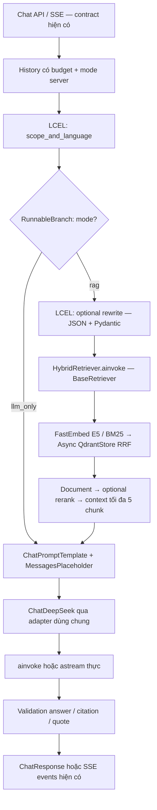

# IndexBeast: LangChain, DeepSeek và pipeline RAG

Triển khai local cho TV3, cập nhật 29/10/2026. Phạm vi: **lore Elden Ring base game**.

## Trạng thái và kiến trúc

| Phần | Trạng thái |
|---|---|
| `mock` | Giữ mặc định và contract API cũ cho TV4 |
| `llm_only` | `ChatPromptTemplate → ChatDeepSeek`; đã kiểm thử bằng fake, chưa gọi API thật trong lượt này |
| `rag` | LCEL nối các bước scope/rewrite/retrieval/rerank/context; generation/citation và SSE dùng chung; kiểm thử offline |
| FastEmbed E5/BM25 | Implementation lazy; chưa tải model hoặc chạy inference thật trong lượt này |
| Qdrant | Đã kiểm thử Query API bằng local memory và vector số giả; chưa kiểm thử Qdrant server thật |
| Reranker | Protocol + `NoReranker` giữ thứ tự; chưa triển khai/chốt model hoặc ngưỡng benchmark |
| Corpus | Cần artifact được review, chưa index hoặc kết luận chất lượng corpus |
| History/feedback | Giữ API hiện tại; service live lưu history RAM, feedback chỉ kiểm message tồn tại như mock |

`ChatService` → `ChatPipeline.prepare_chain.ainvoke()` → `Generator` dùng chung JSON/SSE. `llm_only` không tạo
encoder hoặc retriever, không truy cập Qdrant. Không có web fallback hoặc fallback giữa mode.



LCEL có các bước riêng `scope_and_language`, `rewrite`, `hybrid_retrieve`, `optional_rerank`,
`select_numbered_context`, `prepare_chat_prompt`. Generation và rewrite đều chạy chuỗi prompt → model
LangChain; không bọc toàn bộ pipeline cũ trong một `RunnableLambda`. Nhánh static (ngoài scope, hỏi lại,
thiếu bằng chứng) kết thúc trước model. Service `mock` vẫn dùng implementation cũ.

## Phần giữ lại và lựa chọn tích hợp

| Thành phần | Quyết định |
|---|---|
| `app/adapters/llm.py` | Giữ interface `complete/complete_json/stream`, thay inference bằng `ChatDeepSeek` |
| Prompt/history | `ChatPromptTemplate`, `MessagesPlaceholder`; system policy, history đúng role, evidence trong human payload |
| Retriever online | `HybridRetriever(BaseRetriever)` bất đồng bộ, trả `Document`; giữ `retrieve()` tương thích |
| Orchestration | LCEL `RunnableLambda`, `RunnableBranch`, `RunnablePassthrough`, prompt/model pipe |
| FastEmbed/QdrantStore | Giữ thuật toán/prefix/schema/filters/RRF, tái sử dụng encoder và `AsyncQdrantClient` |
| Indexing/ID/metadata | Giữ CLI, dry-run, approval gate, point/document mapping và provenance |
| Scope/budget/rerank/citation | Python/Pydantic riêng vì là chính sách nghiệp vụ; framework không chứng minh entailment |
| API, history, feedback | Giữ format dự án; không trả message/event LangChain ra client |

**Chọn B: custom async BaseRetriever.** `QdrantVectorStore` của `langchain-qdrant` cũng hỗ trợ dense/sparse
hybrid qua Query API. Với code hiện có, B tái sử dụng trực tiếp async client, `dense`/`bm25`, bộ lọc ở cả
prefetch/fusion và payload nguyên vẹn. Không cần thêm lớp vector store/embedding hoặc thay schema collection.
Đây là lựa chọn giảm thay đổi, không phải kết luận QdrantVectorStore không làm được hybrid.

`Document.page_content` giữ `text`; `Document.id` là point ID. Metadata tách `point_id`, `retrieval_score`,
`payload` (bản sao sâu toàn bộ nguồn) để không đụng tên cột gốc. `document_to_hit()` kiểm text không bị đổi;
`embedding_text`, timestamp, revision, artifact/DB ID và các trường bổ sung round-trip nguyên vẹn.
Không dùng splitter LangChain chia lại chunk hoặc tính lại ID của TV1/TV2.

File chính của refactor: [llm.py](../adapters/llm.py), [pipeline.py](pipeline.py),
[generator.py](generator.py), [retriever.py](retriever.py), [rewrite.py](rewrite.py),
[prompt factories](prompts/__init__.py). Dependencies ở [requirements.txt](../../requirements.txt),
[constraints.txt](../../constraints.txt); unit test ở `backend/tests/unit/test_llm.py`,
`test_live_chat.py`, `test_rag_indexing.py`. Dev usage schema và snapshot OpenAPI đồng bộ giá trị usage nullable.
Wiring/lifecycle ở [context.py](../context.py), [factory.py](../services/factory.py);
dev endpoint/schema ở `app/api/routes/llm_test.py`, `app/api/schemas/llm_test.py`. Test fixture tắt remote tracing
ở `tests/conftest.py`; README gốc trỏ về hướng dẫn này. Các thay đổi pipeline/indexing còn dang dở có sẵn
trước refactor được giữ trong working tree; không reset hoặc ghi đè để tạo nhánh sạch.

## Dependency và cấu hình model

| Package | Version | Vai trò |
|---|---|---|
| `langchain-core` | `1.7.1` | Prompt, message, Document, BaseRetriever, LCEL |
| `langchain-deepseek` | `1.1.1` | ChatDeepSeek |
| `langchain-openai` | `1.7.3` | Dependency của integration DeepSeek, không tạo đường gọi model thứ hai |
| `langsmith` | `0.14.14` | Dependency core; tracing bị tắt tại các entry point inference/pipeline |

Các dependency mới được resolve cùng toàn bộ pin sẵn có, thêm closure vào constraints; không ghi đè bằng
`pip freeze` Windows, giữ nguyên marker Linux/Windows. `openai==3.33.0`, `fastembed==0.9.0`,
`qdrant-client==1.19.1` vẫn giữ pin cũ. Không cài `langchain`, `langchain-qdrant` hoặc LangGraph.

Cập nhật môi trường của bạn, từ **backend** (lệnh cài thư viện, không tải model):

```powershell
.venv/Scripts/python.exe -m pip install -r requirements-dev.txt -c constraints.txt
.venv/Scripts/python.exe -m pip check
```

`LLM_MODEL`, key, base URL, timeout/retry, temperature và output limit lấy từ Settings. Model/client tạo
một lần trong lifespan. Thinking gửi `extra_body.thinking`, chỉ gửi temperature khi non-thinking;
reasoning effort chỉ gửi khi thinking. JSON dùng `response_format={"type":"json_object"}` và Pydantic
validate sau, không giả định mọi model hỗ trợ tool calling/JSON schema. Cần bạn tự kiểm tính tương thích
với model thực tế đang cấu hình; không thay tên model dựa vào ví dụ tài liệu.

Usage non-stream đọc metadata trả về; thiếu thì `None`/JSON `null` (kể cả dev test endpoint), không bịa số 0.
Streaming chưa tổng hợp usage vào trace. Không gửi private reasoning trong chat/SSE hoặc xuất trace ra
LangSmith tự động. Dev test endpoint vẫn giữ trường reasoning riêng theo contract đã có, không ghi log.

`ManagedChatDeepSeek` chỉ bổ sung đóng provider iterator cho native `_astream`; không gọi SDK inference
riêng. Một producer task sở hữu LCEL stream, queue giới hạn một message và stop signal xử lý cancel/close.
Nhờ vậy route có thể prime stream rồi chuyển cho SSE task; đóng sớm/hủy đóng cả HTTP response. Có test
HTTP MockTransport cho text/JSON và fake model cho pipeline. Khi nâng integration cần chạy lại các test này.
Không retry toàn stream sau khi đã phát nội dung.

Tài liệu chính thức đã đối chiếu:
[ChatDeepSeek](https://docs.langchain.com/oss/python/integrations/chat/deepseek),
[QdrantVectorStore](https://docs.langchain.com/oss/python/integrations/vectorstores/qdrant),
[DeepSeek JSON Output](https://api-docs.deepseek.com/guides/json_mode/).
Phiên bản và yêu cầu dependency được đối chiếu metadata PyPI của các bản pin; HTTP payload được kiểm offline.

AppContext vẫn đăng ký hạ tầng cho `/health`, vì vậy `/health` có thể trả 503 khi DB/Qdrant/Redis tắt,
trong khi `/chat` ở `llm_only` vẫn dùng được. Riêng `llm_only` không khởi tạo Qdrant client hoặc reranker;
chỉ khi chủ động gọi `/health`, probe Qdrant mới tạo client riêng và tái sử dụng đến lúc shutdown.
Không dùng health check để gọi model trả phí. Qdrant client tắt compatibility probe lúc khởi tạo;
kết nối được kiểm qua health/retrieval, không ở lúc tạo app.

Handover TV2 mới mô tả chunker trên nhánh riêng. Nhánh nền của tác vụ này **chưa có** `ingest/chunk/runner.py`
và clean/chunk CLI mới; chỉ đọc contract bằng `git show` từ nhánh TV2 để viết adapter, không cherry-pick/sửa
phần của TV2. Khi tích hợp cần giữ dispatch `index` đồng thời với các lệnh clean/chunk của TV2.

## Prompt thực tế

- [persona.md](prompts/persona.md): IndexBeast, 4 Hollows, VI/EN, base-game lore, giới hạn chủ đề và spoiler.
- [llm_only.md](prompts/llm_only.md): cho dùng kiến thức mô hình; cấm giả nguồn/citation/tra cứu corpus.
- [answer.md](prompts/answer.md): chỉ dùng context, JSON answer/evidence/insufficient, quote nguyên văn và `[n]`.
- [rewrite.md](prompts/rewrite.md): `standalone_query_en`, `lang`, `entities`, `out_of_scope`, `ambiguous`.

System và dữ liệu được tách role; lịch sử không phải nguồn bằng chứng. Gate từ khóa chỉ là lớp sơ bộ,
không phải bộ phân loại scope toàn diện; persona/rewrite bổ sung chính sách nhưng chưa được benchmark.
Nhận diện ngôn ngữ `auto` dùng dấu Unicode; câu Việt không dấu nên chọn `options.lang=vi` rõ ràng.

## Cấu hình mới

Giá trị mẫu nằm trong [`.env.example`](../../../.env.example); không sửa `.env` thật trong tác vụ này.

| Biến | Mặc định | Vai trò |
|---|---|---|
| `CHAT_MODE` | `mock` | `mock`, `llm_only`, `rag`; do server quyết định |
| `CHAT_HISTORY_MESSAGES` | `8` | Tin gần nhất đưa vào context |
| `CHAT_HISTORY_CHARS` | `8000` | Budget history; không cắt tin ở giữa |
| `RAG_COLLECTION` | `lore_chunks` | Collection đã xác minh schema |
| `RAG_PREFETCH` | `30` | Số ứng viên dense/sparse và RRF, theo FR-RET-02 |
| `RAG_TOP_K` | `5` | Tối đa 5 chunk cho generation |
| `RAG_CONTEXT_CHARS` | `12000` | Budget context generation theo ký tự JSON, giữ nguyên chunk |
| `RAG_REWRITE_ENABLED` | `false` | Bật rewrite có thêm lượt gọi DeepSeek |
| `RAG_MODELS_DIR` | `models/fastembed` | Cache từ thư mục backend |
| `RAG_BATCH_SIZE` | `32` | Batch index |

Lựa chọn model/temperature/output/timeout vẫn dùng `LLM_*` qua adapter hiện có. Không hardcode model
DeepSeek trong pipeline. Docker Compose truyền các biến mới vào service `api`; đổi env cần recreate container.
Chỉ hỗ trợ RAG text, không có model ảnh. 450/512 token E5 là budget khác với ký tự context generation.

SRS ghi top-K sau rerank mặc định 6; tác vụ hiện tại yêu cầu context tối đa **5**, nên cấu hình này dùng 5.
Reranker/threshold và tính incremental/hash-skip/job DB trong kiến trúc tổng thể chưa được triển khai đầy đủ;
không diễn giải index upsert idempotent hoặc mode llm_only là đã nghiệm thu các yêu cầu đó. Không sửa SRS.

## Tự chạy llm_only khi chưa có dữ liệu

**Các bước dưới đây gọi DeepSeek thật và có thể dùng credits. Chưa được trợ lý thực thi.**

1. Trong `.env` gốc repo, giữ key DeepSeek Platform của bạn và đặt `CHAT_MODE=llm_only`.
2. Kích hoạt venv backend rồi từ gốc repo chạy `make api` để đọc `API_PORT` và chỉ bind loopback.
   Hoặc dùng lệnh PowerShell bên dưới, không cần activate.
3. Swagger `/api/docs` có `POST /api/v1/chat` và `POST /api/v1/chat/stream`.

Body mẫu (không đưa key vào request):

```json
{
  "message": "Ranni là ai? Trả lời ngắn gọn.",
  "channel": "web",
  "options": {"lang": "vi", "spoilers": true}
}
```

Khởi động API bằng PowerShell từ gốc repo, giữ terminal này mở:

```powershell
Set-Location backend
$apiPort = & .venv/Scripts/python.exe -c "from dotenv import dotenv_values; print(dotenv_values('../.env')['API_PORT'])"
.venv/Scripts/python.exe -m uvicorn --factory app.main:create_app --reload --host 127.0.0.1 --port $apiPort --no-access-log
```

Ví dụ JSON bằng PowerShell từ gốc repo:

```powershell
$apiPort = & backend/.venv/Scripts/python.exe -c "from dotenv import dotenv_values; print(dotenv_values('.env')['API_PORT'])"
$body = @{message='Ranni là ai?';channel='web';options=@{lang='vi';spoilers=$true}} | ConvertTo-Json -Depth 3
Invoke-RestMethod -Method Post -Uri "http://127.0.0.1:$apiPort/api/v1/chat" -ContentType 'application/json; charset=utf-8' -Body ([Text.Encoding]::UTF8.GetBytes($body))
```

Ví dụ xem SSE từ gốc repo, chỉ chạy khi bạn muốn gọi model thật:

```powershell
@'
import httpx
from dotenv import dotenv_values
port = dotenv_values('.env')['API_PORT']
body = {'message': 'Who is Ranni?', 'channel': 'web', 'options': {'lang': 'en'}}
with httpx.stream('POST', f'http://127.0.0.1:{port}/api/v1/chat/stream', json=body, timeout=120) as response:
    response.raise_for_status()
    for line in response.iter_lines():
        print(line, flush=True)
'@ | backend/.venv/Scripts/python.exe -X utf8 -
```

`llm_only` luôn `grounded=false`, `sources=[]` và có một thông báo ngắn chưa đối chiếu kho tri thức.
Thiếu key trả `503 unavailable`; lỗi provider trả `502 upstream_error`; không trả mock thay thế.

SSE thật đi qua adapter stream, có buffer mệnh đề để kiểm URL/citation bị chia giữa các token và giải mã
JSON answer khi dùng RAG. Không tách câu trả lời hoàn chỉnh thành từ để giả streaming ở mode live.
Vì vậy không cam kết mỗi token provider lập tức thành một SSE event; câu ngắn có thể chỉ có một delta.
Provider được prime trước headers; lỗi sau khi đã gửi event trả `error` rồi đóng, không có `done` thành công.
Client ngắt/hủy đóng iterator và nhả khóa; turn chưa hoàn tất không được lưu như câu trả lời thành công.

## Nối artifact và bật RAG sau

Adapter tại [ingest/indexing.py](../../ingest/indexing.py) nhận JSONL theo contract `s2-chunk-1.0` của TV2.
Các trường tối thiểu: `chunk_id`, `source`, `source_id`, `title`, `section`, `text`, `embedding_text`, `url`,
`game_scope`, `source_type`, `lang`, `token_count`. Các trường bổ sung được giữ nguyên trong payload.

**Không gán approval hàng loạt.** TV2/TV3 cần cung cấp bản artifact đã review riêng với
`review_status="approved"` theo từng record; `game_scope="base"` heuristic của TV2 chưa đủ. Adapter từ chối
review/excluded, scope khác base và source_type/lang unknown; báo dòng bị từ chối. Nếu có dòng lỗi,
CLI dừng trước khi tạo client hoặc ghi vector. Không tự chỉnh hoặc ghi lại artifact đầu vào.

Từ backend, các lệnh sau chỉ để người dùng tự thực hiện khi dữ liệu đã sẵn sàng:

```powershell
# Chỉ đọc/validate contract, không model, client hoặc network.
.venv/Scripts/python.exe -X utf8 -m ingest index --input data/reviewed/chunks.jsonl --dry-run
# Có thể tải model, chạy embedding và ghi Qdrant thật: chỉ chạy khi bạn chủ động.
.venv/Scripts/python.exe -X utf8 -m ingest index --input data/reviewed/chunks.jsonl
```

Sau index thành công, tự đặt `CHAT_MODE=rag`, xác nhận `RAG_COLLECTION` và restart API. Không có collection
hoặc hạ tầng lỗi trả unavailable; collection rỗng cũng báo chưa sẵn sàng trước khi load encoder.
Collection có dữ liệu nhưng không tìm thấy bằng chứng trả câu thiếu thông tin
với nguồn rỗng. Không có fallback sang kiến thức mô hình.

E5 custom registration dùng FastEmbed ONNX, mean pooling, normalized 384 chiều; sparse `Qdrant/bm25`.
Prefix chỉ được thêm một lần, prefix sai/lặp hoặc vượt 512 token báo lỗi. Tokenizer thật được kiểm trước
embedding thay vì truncate âm thầm. Model load/inference trong thread, dùng lock và tái sử dụng một encoder
mỗi app; cancellation không nhả lock trước khi worker đã kết thúc.

Dense 384 cosine + sparse BM25 IDF, metadata indexes và filters base/approved được áp dụng ở cả hai nhánh
prefetch và fusion. Khi tắt spoiler, chỉ lấy record có `spoiler_level <= 0`; thiếu nhãn không được coi là an toàn.
Schema không tương thích báo lỗi, không drop/recreate collection. Index theo batch có thể đã ghi một số
batch trước khi lỗi ở batch sau; chạy lại cùng artifact upsert cùng ID. Chưa có transaction xuyên các batch
hoặc tự xóa điểm phiên bản cũ khi chunk đã thay đổi.

## ID, timestamp và grounded

ID chunk TV2 là hash unit/span/config/content, còn DB TV1 dùng UUID theo document/ordinal. Adapter không
thay thuật toán nào: `document_id` dùng hàm TV1; point UUID v5 dùng namespace hiện có cùng document UUID
và artifact chunk ID, có tên mapping `artifact-point-v1`. Payload giữ `doc_id`, `chunk_id`, `artifact_chunk_id`,
revision và metadata nguồn. Đây **chưa phải ghi bảng chunks**: khi nối PostgreSQL, TV1/TV3 phải lưu quan hệ
DB chunk UUID ↔ qdrant_point_id ↔ artifact_chunk_id; không dùng point UUID giả làm ordinal chunk UUID.

`source_updated_at=null` được giữ nguyên. `updated_at` của artifact vẫn là thời điểm sinh artifact,
không tự đổi thành thời điểm nguồn sửa.

RAG yêu cầu model trả JSON `{answer,evidence,insufficient}`; stream yêu cầu `answer` là trường đầu.
Adapter stream bật `response_format=json_object` theo [DeepSeek JSON Output](https://api-docs.deepseek.com/guides/json_mode/),
đồng thời prompt có ví dụ JSON. JSON mode không thay thế validation schema/citation ở ứng dụng.
`grounded=true` chỉ khi model trả lời có bằng chứng, citation khớp evidence, từng quote là substring nguyên
văn trong context được chọn và mỗi đoạn có citation. Sources lấy từ metadata server, không tin URL model sinh.
Chỉ trả nguồn đã được trích. Đây là **policy kiểm grounding hình thức và đoạn chứng cứ**, không phải
entailment judge, không bảo đảm từng claim thực sự được quote suy ra. Cần review/eval riêng trước báo chất lượng.
Kiểm tra bằng chứng cuối stream thất bại sau token đã phát sẽ kết thúc bằng error; client phải bỏ trạng thái
thành công, không coi các token tạm là câu trả lời đã xác minh.

History live giữ tối đa 500 hội thoại, 64 tin/hội thoại; trace chẩn đoán giới hạn 1000 lượt trong RAM,
không log prompt/key, không bịa usage streaming. Restart/multi-worker không chia sẻ dữ liệu. Feedback chưa
lưu DB, endpoint đọc history chưa thay thế auth; không triển khai như production hoàn chỉnh.

## Kiểm thử và phối hợp

Từ backend, chỉ chạy offline:

```powershell
.venv/Scripts/python.exe -X utf8 -m pytest -c pyproject.toml tests/unit -q
.venv/Scripts/python.exe -X utf8 -m ruff check .
.venv/Scripts/python.exe -X utf8 -m ruff format --check .
.venv/Scripts/python.exe -X utf8 -m scripts.export_openapi --check
```

Không chạy pytest từ gốc repo không chỉ định cấu hình: nó có thể collect integration và route tên `test_llm`.
Lượt xác minh chỉ lấy `tests/unit` theo pyproject. Test Qdrant dùng local memory, vector số tổng hợp,
không chạy model; payload index thật cần Qdrant server để kiểm sau.

Baseline trước refactor LangChain ngày 28/10/2026: **134 unit test đạt**. Sau refactor ngày 29/10: **146 unit test đạt**.
Ruff check/format, kiểm tra OpenAPI và `pip check` đều đạt; dependency dry-run không yêu cầu thay gói nào thêm.
Có một warning dự kiến: Qdrant local không thực thi payload index như server. Các test mới dùng provider fake,
contract artifact tổng hợp và vector số giả; không có số đo chất lượng retrieval trên corpus thật.

Test bổ sung kiểm prompt role/braces qua model LangChain, metadata round-trip không alias, rerank rồi top-5,
spoiler filter theo request không đổi retriever dùng chung, llm_only không tạo retrieval infrastructure,
health probe lazy được đóng đúng, wire payload thinking/JSON, usage thiếu, cấu hình
model/transport, đóng sớm qua LCEL chuyển task và hủy provider đang chờ. Các assertion nghiệp vụ trước đó
vẫn giữ. Chưa kiểm Docker/Linux, server Qdrant, corpus thật hoặc DeepSeek thật; test offline không chứng minh
chất lượng trả lời lore, retrieval hay khả năng của model provider.

- TV1: review service wiring, lỗi 503, OpenAPI, mapping ID, persistence và bảo vệ API trước khi mở Internet.
- TV2: review contract artifact, approval theo record, source_type/lang unknown và giới hạn tokenizer.
- TV4: API/schema và SSE event giữ nguyên; response ungrounded vẫn có thể là LLM trả lời, không phải lỗi.
  Có nhãn ngắn trong answer; không hiển thị nguồn giả khi `sources=[]`. Các file web/bot không bị sửa.
  Web hiện hiển thị thêm nhãn chung “Chưa tìm được đủ bằng chứng trong kho nguồn” khi grounded=false;
  nội dung answer vẫn được hiển thị. TV4 có thể tinh chỉnh nhãn này cho chế độ LLM trong tác vụ riêng.
- TV3: chốt/benchmark reranker, đánh giá corpus/nguồn và chất lượng sau. Không dùng bộ golden set làm dữ liệu RAG.

Không cập nhật SRS/Trello, không đánh dấu toàn bộ S2/S3 Done. Đây là tác vụ local, không có commit/push hoặc
handover riêng; hướng dẫn này là entry point sử dụng phần code mới.
