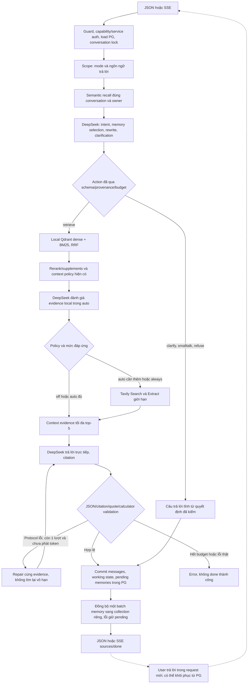

# Agent decisions và semantic memory lưu bền

06/11/2026 · TV3 — MinhMuc · IndexBeast / 4 Hollows.

## Trạng thái

Sau khi người dùng khôi phục hạ tầng và yêu cầu chạy setup, PostgreSQL local đã lên revision **0002**,
collection memory đã được tạo. Bộ thử thật **đã hoàn tất đúng 20 lượt** trên DB/collection test riêng:
xem [kết quả live và nhận xét](../testing/2026-11-06_agent-memory-20-live/README.md).
Report [preflight bị chặn trước đó](../testing/2026-11-06_agent-memory-20/README.md) được giữ nguyên làm lịch sử.
Không sửa `.env` thật, không reindex corpus. HTTP 200 cả 20 lượt không có nghĩa tất cả trả lời đúng.

`CHAT_AGENT_ENABLED=true` là default code cho mode RAG. `CHAT_PERSISTENCE=memory` vẫn là default an toàn
cho môi trường chưa chuẩn bị migration. **Lưu bền/semantic cần bật PostgreSQL sau khi setup**; không giả
default RAM đã nhớ lâu dài. Mode mock vẫn mặc định toàn ứng dụng, llm_only không bị đổi thành RAG.

## Quyết định nào thuộc mô hình

| Mô hình quyết định | Backend kiểm soát |
|---|---|
| Intent và loại lượt new/followup/correction/clarification reply | Quyền conversation/capability/service token |
| Có cần rewrite, resolve chủ thể và search query | Schema, literal tên/giá trị có provenance, số, goal, phủ định |
| User memory nào liên quan | Scope, candidate/context budget, trạng thái active/revision |
| Có cần hỏi lại, hỏi trường nào | Clarification ID/TTL, tối đa 2 field, không giữ HTTP chờ người dùng |
| Evidence local đáp ứng chưa | Citation/quote/source metadata, off/auto/always và tool allowlist |
| Câu trả lời và gợi ý có điều kiện | Deadline, model-call budget, RRF/top-5, calculator và validation |

Decision dùng `AgentDecision` JSON có intent, turn_type, action, rewrite, resolved_question, search_query,
entities, selected_memory_ids, constraints có source_id, missing fields, reply và reason code.
Không in chain-of-thought. Intent `build` không bắt buộc cùng một bộ field cho mọi câu hỏi;
weapon/class không bị giới hạn bởi danh sách mẫu của parser cũ.

Planner gộp intent, clarification và rewrite trong một call. `_QUESTION_WORDS`, regex `intent_of`/`extract`/
`advance`, lexical memory và legacy rewrite **không làm nguồn quyết định trong đường agent mặc định**.
Code cũ được giữ làm đường tương thích khi chủ động đặt `CHAT_AGENT_ENABLED=false`; không tự fallback
sang đường này khi model lỗi. PostgreSQL RAG yêu cầu agent=true để không giả legacy PlayerState đã được serialize.

Server kiểm tra constraint value xuất hiện trong nguồn user đã cấp; current message ưu tiên correction.
Đây là kiểm tra provenance/literal, không phải chứng minh mô hình hiểu đúng nghĩa hay quan hệ canon.
Guard không dùng lại classifier tên/intent cũ làm allowlist. Những quyết định sai về nghĩa vẫn cần review thực tế.

Planner trả schema không hợp lệ: trace `invalid_decision`, hỏi rõ lại có giới hạn. Provider lỗi/timeout thật
trả lỗi upstream/unavailable, không giả làm câu hỏi thành công. Conversation-control reply không được bịa URL/citation.

## Luồng hệ thống



Memory candidate được cấp cho decision model, không cấp cho assessor/generator làm evidence.
`resolved_question`/`search_query` là English khi model rewrite; ngôn ngữ trả lời vẫn từ server/request.
Dual retrieval giữ English trước và query gốc VI cho câu độc lập; follow-up dùng chủ thể đã resolve,
không search riêng “nói tiếp”/“nó”. Rank fusion không cộng điểm khác thang đo.

Graph state là riêng từng invocation, không append reducer và không shared thread/checkpointer.
Không lưu client, encoder, secret vào checkpoint vì không cấu hình checkpoint mới.
Auth/lock/commit vẫn ở service boundary, không giả là các node có khả năng giao dịch phân tán.

## Lưu trữ và semantic recall

| Thành phần | Nơi lưu | Ý nghĩa |
|---|---|---|
| Conversation/message gốc | Bảng PostgreSQL hiện có | Source of truth; toàn bộ cặp turn hoàn tất |
| Working constraints và pending clarification | `conversation_runtime` | JSON state + optimistic revision; pending TTL 30 phút |
| User topic/fact có provenance | `conversation_memories` | Active/superseded, source message UUID, timestamp, revision |
| Vector memory | Collection `CHAT_MEMORY_COLLECTION` riêng | Named dense 384 cosine; E5, không BM25 |
| Corpus | Collection cũ | Không thay ID, schema, metadata hay reindex corpus |

Topic là câu hỏi đã resolve, liên kết user message gốc; fact chỉ từ giá trị user đã nói/xác nhận.
Assistant answer được lưu để hiển thị, không embed thành bằng chứng hoặc ký ức factual độc lập.
Topic cũ không tự xác nhận profile hiện tại. Correction mới supersede fact cùng key, không ghi đè lịch sử gốc.

E5 dùng chung instance/lock với corpus retriever. Dense-only memory không tạo BM25.
Model lazy trong worker, query:/passage: một lần, kiểm tokenizer 512 tokens và không truncate.
Input quá dài được giữ ở PG, ghi trạng thái skip indexing; không giả đã tạo vector.

Recall lấy tối đa `CHAT_MEMORY_CANDIDATES` vector theo cosine, thêm tối đa 2 user-topic gần nhất;
dedup ID và giữ tổng count/char theo history budget. Mô hình chọn các ID thực sự liên quan hoặc hỏi lại.
Không dùng một ngưỡng cosine chưa đo để tự kết luận đúng chủ thể.
Không cộng recency vào cosine; recent được đánh nhãn riêng. Vector không có nội dung chat plaintext.

Query filter gồm conversation UUID, owner hash, active, embedding model/version.
Mọi hit phải đối chiếu lại PG scope/status/revision trước khi dùng, không tin riêng payload Qdrant.
Version `e5-small-384-prefix-v1` là protocol tag, không phải hash weights đã được xác minh.

Message UUID ổn định khi client gửi turn_id: UUID5(conversation, user/assistant + turn_id).
Memory UUID = UUID5(conversation, topic + user-message-ID) hoặc fact + message-ID + key;
Qdrant point ID bằng memory UUID. Upsert lặp cùng ID không nhân bản. Mapping corpus giữ nguyên.

`indexed_revision` là trạng thái đồng bộ tối thiểu, không có framework queue mới.
PG commit nguyên tử trước; upsert/delete vector một batch giới hạn 16, mark bằng revision CAS.
Nếu lỗi, PG vẫn là source of truth và còn pending để operator sync lại. Stale point không cấp quyền dùng memory.
Không tự drop/recreate collection. `rebuild` đánh dấu cần dựng lại cho một conversation, không đụng corpus.

## Quyền và contract TV4

Web conversation PostgreSQL mới trả `conversation_token` ngẫu nhiên; PG chỉ lưu SHA-256.
Client gửi lại trong body POST chat, dùng header `X-Conversation-Token` cho GET history/feedback.
UUID conversation không đủ quyền. Token chỉ thuộc một conversation, không có cross-chat/account memory.
Không ghi token vào prompt, trace hoặc handover.

Các field tùy chọn mới:

- Request: `conversation_token`, `turn_id`.
- JSON response và SSE done: `conversation_token` khi cần; legacy/mock bỏ field nếu None.

Transport web đã giữ token qua JSON/SSE và localStorage; gửi turn_id từ ID user message.
Không đổi thiết kế giao diện. Client cũ vẫn dùng mode RAM; conversation PG cần token.
History API trả tối đa 64 message như trước, nhưng DB lưu mọi turn hoàn tất và semantic recall không phụ thuộc window này.
Feedback giữ contract 204, kiểm được message sau restore; chưa thêm hệ feedback persistence mới.

Retry cùng conversation/token/turn_id và nội dung sẽ replay answer đã commit, không gọi model lại.
Cùng ID nhưng nội dung khác trả 400. Client tự retry cần giữ nguyên turn_id; nút gửi mới là turn mới.
Không đảm bảo exactly-once khi response tạo conversation đầu tiên bị mất trước khi client biết ID/token.
Optimistic revision ngăn ghi đè giữa worker; xung đột có thể trả 503, không phải distributed queue hoàn chỉnh.

Discord POST vẫn cần service token hợp lệ và external_ref; model không đổi policy auto.
Shared `discord:thread:` không có actor identity trong contract cũ: chỉ public topic context,
không cấp fact memory hoặc working profile cá nhân của người khác. Không hứa private/personal resume trong shared thread.

Raw history không tự hết hạn; retention do operator quy định. Cancel dừng pending task, không xóa dữ liệu đã lưu.
Mất localStorage/token chưa có cơ chế khôi phục tài khoản. RAM cũ không tự được migrate sang PostgreSQL.

## Ngân sách và lỗi

`CHAT_AGENT_MAX_CALLS=6` là giới hạn logical model calls/lượt: decision, assessment và generation/repair.
SDK transport retries vẫn có giới hạn riêng `LLM_MAX_RETRIES`; runner live đặt 0 để đếm chi phí rõ ràng.
Decision tối đa một call; generation có tối đa một repair, không retry sau token hiển thị.
Tavily chỉ một Search + một Extract batch, không loop tìm đến khi “ra đáp án”.
Deadline `CHAT_TIMEOUT_SECONDS` gồm chờ lock, memory, model/tool và lưu; client/provider được đóng khi hủy.
PG commit và client acknowledgement là hai thời điểm khác nhau: timeout/mất kết nối sau commit có thể cần replay.
CPU ONNX không bị cưỡng bức kill; encoder giữ lock đến khi worker dừng để tránh chạy song song trên cùng model.

Thiếu evidence thông thường không tự thành 502. Lỗi provider thật hoặc output vẫn sai sau budget vẫn trả lỗi đúng loại.
Citation/quote validator chưa chứng minh entailment. Không gọi HTTP 200 hoặc grounded=true là correctness.

## Setup

**Đã thực hiện ngày 06/11/2026:** `alembic upgrade head` và `memory_admin setup --apply` trên local DB
`indexbeast`, sau yêu cầu của người dùng. DB từ rỗng lên 0001 rồi 0002; collection `conversation_memories`
dense 384 cosine, 5 keyword indexes, 0 point. Corpus giữ 18.368 point.
Xem [biên bản kiểm tra setup](../testing/2026-11-06_memory-setup.json).
Các lệnh dưới dùng lại khi setup môi trường tương ứng từ gốc project:

```powershell
make up
Push-Location backend
.venv/Scripts/python.exe -X utf8 -m alembic current
.venv/Scripts/python.exe -X utf8 -m alembic upgrade head
.venv/Scripts/python.exe -X utf8 -m scripts.memory_admin setup --apply
Pop-Location
```

Đặt thủ công trong `.env` của máy sử dụng, sau khi migration 0002 và collection setup thành công:

```dotenv
CHAT_MODE=rag
CHAT_AGENT_ENABLED=true
CHAT_PERSISTENCE=postgres
CHAT_MEMORY_COLLECTION=conversation_memories
CHAT_MEMORY_CANDIDATES=6
CHAT_MEMORY_TIMEOUT_SECONDS=5
```

Restart `make dev`, tạo conversation mới. Không cần reindex corpus. `.env` thật chưa sửa;
settings hiện tại vẫn `CHAT_PERSISTENCE=memory`, vì vậy chạy app thông thường chưa tự chuyển sang lưu bền.
Có thể bật cho terminal PowerShell hiện tại mà không sửa file:

```powershell
$env:CHAT_PERSISTENCE = "postgres"
make dev
```

Đây là hướng dẫn khởi chạy, chưa chạy thay người dùng. Không có API/web daemon mới được mở bởi tác vụ setup.

CLI mặc định chỉ in plan, không tạo client/model hoặc ghi dữ liệu:

```powershell
Push-Location backend
.venv/Scripts/python.exe -m scripts.memory_admin setup --dry-run
.venv/Scripts/python.exe -m scripts.memory_admin sync --conversation <UUID> --apply
.venv/Scripts/python.exe -m scripts.memory_admin rebuild --conversation <UUID> --apply
Pop-Location
```

`<UUID>` là placeholder để thay, không nhập nguyên dấu ngoặc. Đây là CLI operator có quyền DB,
không phải API public. Sync/rebuild xử lý một batch; lặp sync nếu còn pending. Rebuild không xóa history.
Rollback vận hành: về CHAT_PERSISTENCE=memory để chạy RAM; chỉ tắt agent khi dùng đường legacy tương ứng.
Không downgrade/drop bảng chỉ để đổi mode; dữ liệu PG giữ lại. Rollback code theo PR/quy ước Git.

## Bộ thử thật 20 lượt

Đã chạy một lần đủ 20 lượt; [báo cáo live](../testing/2026-11-06_agent-memory-20-live/README.md)
ghi riêng HTTP, chất lượng, chi phí gọi và giới hạn. Không tự chạy lượt 21/retest sau sửa guard.

Manifest: `backend/eval/agent_memory_20.json`: 8 golden câu độc lập + 4 scenario x 3 lượt,
10 VI/10 EN, auto, có service recreation, correction, ambiguity và một SSE request.
Chỉ câu hỏi được gửi model, không gửi expected_answer/golden label làm evidence.

Từ backend, plan không gọi model/server:

```powershell
.venv/Scripts/python.exe -X utf8 -m scripts.diagnose_agent_memory
```

Sau khi hạ tầng sẵn sàng, chạy vào **thư mục mới**, không ghi đè report preflight:

```powershell
.venv/Scripts/python.exe -X utf8 -m scripts.diagnose_agent_memory --execute --allow-llm --allow-web --allow-embedding --output ../docs/testing/agent-memory-20-live-new
```

Runner probe read-only trước; chỉ sau đó tạo DB `indexbeast_agent_test_*` và collection `ib_agent_test_*`
riêng, migrate DB test và đọc corpus cũ. Không migrate DB thật hoặc reindex corpus.
Model cache phải có sẵn, không tải weights; rate-limit keys dùng scope test riêng, không flush Redis.
Tối đa 20 POST user turn, 120 logical model calls và một Search/Extract mỗi turn; không tự retest lượt 21.
Report checkpoint nguyên tử từng lượt, giữ cả lỗi, token/latency/decision/memory/evidence; correctness/faithfulness
để None đến khi review thật. Không tự drop resource test hoặc xóa report khi có lỗi.
Blocked/interrupted không phải complete; runner trả exit 2 khi không hoàn tất.

Tham chiếu API: [LangGraph](https://docs.langchain.com/oss/python/langgraph/graph-api),
[Qdrant filtering](https://qdrant.tech/documentation/search/filtering/).
