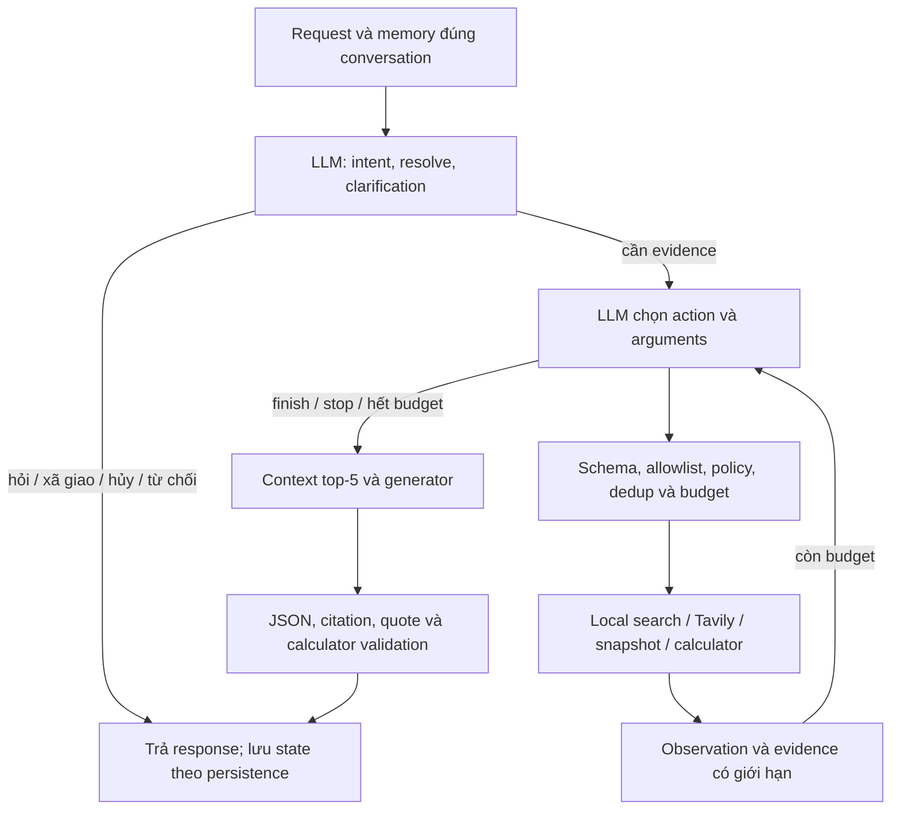

# Agent chọn tool có giới hạn — 06/11/2026

TV3 MinhMuc · IndexBeast / 4 Hollows · nhánh `feature/s3-tv3-bounded-tool-agent`.

## Runtime và chuyển đổi

`CHAT_MODE=rag`, `CHAT_AGENT_ENABLED=true`, `CHAT_TOOL_AGENT_ENABLED=true` (default code mới):



Đây là structured decisions trong node LangGraph `tool_agent`, không phải native tool calling hay agent tự do chạy code.
LangChain vẫn cung cấp prompt/model/retriever. Hỏi người dùng trả HTTP để chờ lượt mới, không giữ kết nối chờ họ nhập.

| File/hàm | Caller / hoạt động khi | Quyết định trong đợt này |
|---|---|---|
| `gameplay.py:intent_of/extract/advance` | Legacy khi agent=false; extract còn là fallback kiểm allocation | Giữ compatibility, không gọi classifier trên đường tool agent |
| `agent.py:decide` | RAG agent | Giữ model quyết định intent, memory, rewrite, clarification |
| `pipeline.py` graph retrieval → assess → web cố định | Agent cũ khi tool_agent=false, hoặc legacy | Đường tool agent mới bỏ qua nhánh này |
| `gameplay_knowledge.py:supplements` keyword/alias | Rerank workflow cũ | Không dùng trên đường mới; LLM chọn snapshot ID trong catalog |
| `tool_agent.py` | Agent mới | Model chọn tool, query mới, clarification, finish/stop từ observation |
| `build_math.py:check_allocation` | Tool có đủ accounting sources và generator | Giữ kiểm phép tính Samurai/Moonveil; không phải tối ưu hoặc AR/DPS solver |
| Auth, corpus policy, filters, RRF, provenance, source IDs, citation | Các tầng thực thi | Giữ; không trao quyền bỏ validation cho model |
| `web_search.py:assess`, câu hỏi fallback tĩnh | Workflow cũ | Không gọi trên đường mới; thiếu context được generator xử lý với evidence rỗng |

Không xóa legacy trong đợt này vì caller/test/compatibility vẫn tồn tại. Test milestone agent cũ chọn rõ
`chat_tool_agent_enabled=False`; assertion của nó được giữ. Test tool agent mới bật true, không gọi legacy classifier/supplements.
Không đổi API JSON/SSE hoặc frontend/Discord, không thêm dependency/asset.

## Tool và giới hạn

- `local_search`: hybrid retriever Qdrant hiện có, giữ filters và dense+sparse RRF.
- `web_search`: Tavily Search + Extract qua adapter hiện có; giữ WebHit origin và unknown metadata.
- `source_snapshot`: ID được model chọn từ catalog nguồn đã qua corpus policy; không match keyword để quyết định.
- `calculator`: chỉ expose khi có đủ bốn loại accounting evidence, kiểm allocation bằng tool đã có. Generator vẫn kiểm lại
  allocation và citations; tool không chứng nhận AR/DPS, soft cap, patch hoặc optimality.
- `clarify`: câu hỏi và fields do model tạo, giữ task gốc và clarification contract hiện có.
- `finish` / `stop`: kết thúc tìm, không trực tiếp phát game facts. Generator chỉ sử dụng context được cấp.

Mỗi step có action, reason code, observation/status; không yêu cầu/lưu chain-of-thought.
Query phải đúng schema và giới hạn ký tự; giữ ý nghĩa/điều kiện được hướng dẫn qua prompt, chưa có semantic proof.
Không shell/crawler/write tool. Model không tự sửa collection/filter/config hoặc lấy memory làm game evidence.

Settings mới trong `.env.example` (không sửa `.env` thật):

```dotenv
CHAT_TOOL_AGENT_ENABLED=true
CHAT_TOOL_STEPS=3
CHAT_TOOL_QUERIES=2
```

Tối đa 3 tool-decision steps, 2 local queries, 1 web Search/Extract batch. Trùng normalized action/arguments bị chặn.
Giữ `CHAT_AGENT_MAX_CALLS=6`, dành ít nhất 1 call cho generation, không tăng deadline 45s để che lỗi.
Generation repair vẫn chịu shared budget. Outer request deadline/cancellation và client lifecycle giữ nguyên.
Local timeout/provider error trở thành observation cho quyết định kế tiếp; không loop vô hạn.
Decision schema/provider lỗi vẫn là lỗi upstream, không giả bằng câu hỏi thành công.

Off không expose web. Auto để model chọn. Always yêu cầu đã thử web trước finish cho game request;
clarification/xã giao/hủy/từ chối trước đó không bị ép search. Provider web lỗi và không có evidence trả unavailable.
SDK retries vẫn do config điều khiển; runner live đặt 0. Test không chứng minh native server/network streaming latency.

## Benchmark tái sử dụng

Từ `D:\Index-Beast\backend`, dùng venv hiện có. Mọi lệnh dưới là hướng dẫn, **chưa tự chạy thêm lượt thật**:

```powershell
# Plan: không tạo client, không gọi mạng hoặc tải model
.venv/Scripts/python.exe -X utf8 -m scripts.benchmark_agent --manifest eval/agent_tools_10.json --max-turns 10

# Manifest nhỏ: lấy 3 lượt đầu, output phải là thư mục mới
.venv/Scripts/python.exe -X utf8 -m scripts.benchmark_agent --manifest eval/agent_tools_10.json --max-turns 3 --execute --allow-llm --allow-web --allow-embedding --output ../docs/testing/tool-agent-my-3

# Resume cùng manifest, budget, output; không gửi lại lượt đã tiêu thụ/kết quả chưa rõ
.venv/Scripts/python.exe -X utf8 -m scripts.benchmark_agent --manifest eval/agent_tools_10.json --max-turns 3 --execute --resume --allow-llm --allow-web --allow-embedding --output ../docs/testing/tool-agent-my-3

# Đọc report
Get-Content ../docs/testing/tool-agent-my-3/report.json -Encoding utf8
```

Manifest tự chọn là JSON array `{id, question, lang, group}`; lang=vi/en, group=null cho độc lập hoặc cùng chuỗi
cho một conversation. Ví dụ thay đường dẫn manifest bằng `eval/my_agent_cases.json` sau khi tự tạo file đó.
Không đưa expected_answer vào câu hỏi/evidence. `--max-turns` là trần toàn run, không phải trần mới mỗi resume.
CLI mặc định plan, execute cần đủ ba cờ allow và output mới; mỗi run có DB/memory collection test riêng.
Preflight kiểm PG/Qdrant/Redis/key/cache trước paid calls; HF offline, không tải weights, không reindex corpus.
Exit 0 complete không lỗi, 1 đã hoàn tất nhưng có lượt lỗi, 2 blocked/interrupted. Plan 0; input sai argparse 2.

Checkpoint nguyên tử từng lượt; tiêu thụ lượt ngay trước request, không replay lượt uncertain.
Capability resume state nằm riêng trong thư mục temp OS với tên hash output path, không trong report/Git;
POSIX mode 600, Windows phụ thuộc ACL thư mục temp người dùng. Mất private state thì block resume scenario,
không tạo conversation mới âm thầm. Di chuyển output/temp hoặc đổi manifest/budget có thể không resume được.
Không tự xóa resource/report. Đọc prefix checkpoint từ report trước resume để tránh vượt ngân sách.

## Kết quả thực tế

Xem [report và review 10 lượt](../testing/2026-11-06_tool-agent-10/README.md).
Chỉ 10 lượt được chạy, 9 HTTP 200 / 1 HTTP 502. Fix schema sau run chỉ replay offline, không gọi lượt 11.
Chưa đủ bằng chứng tuyên bố chất lượng tốt hơn workflow trước hoặc Tavily đã được kiểm chứng live trong đợt này.

Kiểm tra cuối sau fix: **801 backend unit passed**, 2 warning cũ, 30,61s; **41 web tests passed**;
build/typecheck, Ruff, format, pip check và OpenAPI check đạt. Không sửa frontend, bot hoặc asset.
