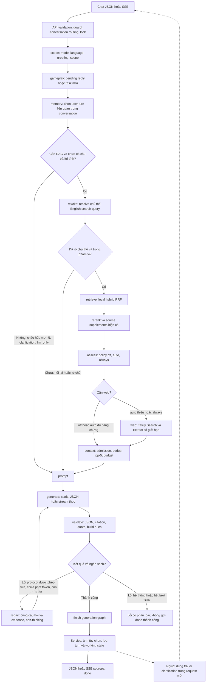

# LangGraph và ký ức hội thoại liên quan

> Tài liệu này mô tả bản lexical đầu tiên. Bản model decisions + semantic memory PostgreSQL tiếp theo
> được mô tả trong [agent-semantic-memory.md](agent-semantic-memory.md); mặc định agent=true,
> persistence vẫn RAM cho đến khi operator setup và bật PostgreSQL.

06/11/2026 · TV3 — MinhMuc · IndexBeast / 4 Hollows.

## Phạm vi bản triển khai

LangGraph thay orchestration LCEL tuyến tính bằng hai graph: chuẩn bị request và generation.
Model/prompt/retriever tiếp tục là component LangChain hiện có. Không phải agent tự do dùng tool tùy ý;
policy server, số truy vấn, top-5, ngân sách và validator vẫn quyết định phạm vi.

API/auth và lock conversation chạy trước graph. Sau graph thành công, service chọn ảnh và commit
conversation/player state, rồi trả JSON hoặc gửi `sources`/`done`. Mode mock dùng service cũ.
Web/Discord không phải đổi schema; nguồn/citation/image vẫn trong contract server hiện có.

## Sơ đồ triển khai



Các node `scope` đến `prompt` thuộc `ChatPipeline.prepare_graph`.
`generate`, `validate`, `repair`, `finish` thuộc `Generator.graph`.
Streaming giữ bộ giải mã và validator incremental trong node generate để kiểm tra trước khi phát phần cuối;
node validate không gọi model hay chạy một lượt kiểm chứng ngữ nghĩa bổ sung.
Auth, lock, optional images và commit ở service boundary, không giả chúng là graph node.

## History được chọn thế nào

1. Sau routing hiện có, lấy tối đa 64 message của conversation làm ứng viên, chưa cắt còn 8 message.
2. Chỉ user turn được xét. Assistant turn vẫn xuất hiện trong lịch sử hiển thị, nhưng không làm ký ức để rewrite/generate.
3. Câu hỏi tự đủ chủ thể hoặc thông báo đổi chủ đề: chọn 0 turn.
4. Câu nói tiếp có nhãn chủ đề: tìm overlap từ khóa sau chuẩn hóa chữ/dấu. Có thể tìm chủ đề cũ hơn 8 message.
5. Đại từ không nhãn chủ đề: dùng chủ thể rõ gần nhất; không nhảy về chủ đề cũ chỉ vì trùng một từ chung.
6. Nhiều chủ thể cạnh tranh, không có anchor hoặc vượt budget: hỏi lại, không gọi model/retriever/web để đoán.
7. Chọn anchor và các correction gần nhất của cùng task, dedup, tối đa `min(CHAT_HISTORY_MESSAGES, 3)`
   user turn và tổng `CHAT_HISTORY_CHARS`; không cắt nửa turn.

Trace `memory` có method, reason, số turn được chọn và provenance message/conversation ID, thời gian.
Không ghi nội dung ký ức vào application logger. Những caller test trực tiếp không có ID thì provenance có thể rỗng.

Đây là lexical recall với surface-name heuristic, **không dùng semantic embedding**.
Tên viết thường hoàn toàn, nickname, paraphrase khác ngôn ngữ hoặc câu tiếp nối ngoài grammar có thể chưa nhận ra.
Không có Recall/MRR thật được đo trong tác vụ này. Không dùng synthetic ranking để tuyên bố chất lượng embedding.

## Ký ức khác bằng chứng

| Thành phần | Được nhận gì | Vai trò |
|---|---|---|
| Rewrite trong RAG | Câu hiện tại + user turn đã chọn | Resolve intent/chủ thể, giữ tên/số/phủ định/goal |
| Local retriever và Tavily | Search query đã resolve | Tìm evidence mới theo policy |
| Evidence assessor | Search query + context local, history rỗng | Kiểm mức đáp ứng của evidence |
| RAG generator | Câu đã resolve + numbered evidence, history rỗng | Trả lời và trích dẫn |
| llm_only generator | Câu hiện tại + user context đã chọn | Hội thoại không retrieval; giữ notice riêng của mode |

Memory không biến thành Hit, Document hoặc source index; assistant từng nói sai không thể tự chứng minh
đáp án mới. Rewrite lỗi với câu tiếp nối sẽ hỏi lại. Câu độc lập rewrite lỗi vẫn fallback nguyên câu theo policy cũ.
Ngôn ngữ trả lời độc lập query retrieval; history không được phép đổi tiếng Việt thành trả lời tiếng Anh.

## Working state, lưu trữ và quyền truy cập

| Thành phần | Hiện lưu ở đâu | Qua restart? |
|---|---|---|
| Conversation hiển thị | RAM, tối đa 64 message/conversation, LRU 500 conversation | Không |
| Memory được chọn | State riêng của một graph invocation | Không |
| Player slot và pending clarification | RAM của conversation, TTL 30 phút | Không |
| Graph checkpoint | Không cấu hình checkpointer | Không có |
| Corpus local | Qdrant/PostgreSQL hiện có, không chỉnh trong task này | Theo hệ lưu trữ hiện có |

Player slot là working state của task, không phải hồ sơ người chơi lâu dài. Task mới bỏ slot cũ;
correction trong task thay level/goal/weapon cũ cả trong working query. Lỗi hoặc hủy trước commit không đổi player state.

Chỉ tìm trong conversation đang được routing; không tìm xuyên conversation hoặc chia sẻ profile giữa người dùng.
Channel/external_ref được kiểm như trước. **Web hiện chưa có danh tính tài khoản/capability xác minh ownership**:
biết UUID conversation không chứng minh quyền sở hữu. Bản này không nâng mức bảo đảm auth của API cũ và không
thêm endpoint tìm ký ức toàn cục. Không dùng shared Discord thread làm hồ sơ cá nhân đã xác minh.
Muốn nhớ xuyên phiên/cross-chat cần thiết kế identity + quyền truy cập + persistence/retention riêng trước.

Không có `CHAT_PERSISTENCE` mới trong code sau revert. Chỉ thêm biến `CHAT_PERSISTENCE=postgres` vào `.env`
không làm chat tự lưu PostgreSQL. Không có migration hoặc collection memory cần setup cho bản này.

## Retry, web và streaming

- `off`: không assess/search web; `auto`: assess local, search khi chưa đủ hoặc assessment lỗi;
  `always`: search với câu hỏi game cần tra cứu. Chào hỏi và hỏi làm rõ không cần web.
- Discord vẫn ép `auto`, không lấy chế độ từ web client.
- Search/Extract giữ giới hạn của adapter hiện có; không retry tool trong graph hoặc chạy vòng tìm kiếm vô hạn.
- `RAG_FORMAT_RETRIES` giữ 0 hoặc 1. Lượt sửa dùng cùng evidence, non-thinking, temperature 0;
  không gọi lại retrieval/search và vẫn qua validator. Lỗi mạng/quote không nguyên văn không được biến thành đủ bằng chứng.
- Giới hạn recursion prepare/generation là 24/12; không gắn RetryPolicy tự lặp tool.
- Một queue bounded và acknowledgement nối graph với SSE: consumer nhận tiếp thì provider mới tiếp tục.
  Hủy stream sẽ cancel và await tác vụ graph/provider. Sau token hiển thị không chạy lại generation.
- `CHAT_TIMEOUT_SECONDS` bao gồm chờ lock, preparation/generation/repair và ảnh; SSE tiếp tục dùng deadline
  của cùng lượt sau token đầu. Timeout/lỗi không lưu turn thành công hoặc gửi `done`.
- Không tìm thấy evidence bình thường trả câu trả lời thiếu thông tin, không mặc định 502.
  Output vẫn sai sau budget hoặc dịch vụ thật lỗi vẫn có thể trả lỗi HTTP đúng loại.

Citation/quote validation là kiểm tra giao thức và đoạn trích, không chứng minh entailment.
Prompt khuyến khích trả lời trực tiếp khi rõ, bỏ disclaimer chung; không sửa temperature để chữa retrieval.

## Cách dùng — người dùng tự chạy

Từ gốc project, cập nhật dependency trong virtualenv backend:

```powershell
backend/.venv/Scripts/python.exe -m pip install -r backend/requirements-dev.txt -c backend/constraints.txt
make dev
```

Không cần sửa `.env`, migration hoặc reindex cho graph/lexical recall. Mode vẫn lấy cấu hình đang có;
`CHAT_MODE=mock` là default code. Muốn thử câu trả lời thật, tự chuẩn bị local corpus/server và key như trước.
Các lệnh trên **chưa chạy trong tác vụ**; chỉ việc cài riêng LangGraph đã được thực hiện để kiểm thử offline.

Ví dụ thử trên cùng conversation:

- `Gia phả Marika` → `nói tiếp về gia phả`.
- Chuyển sang `Ranni là ai?`: không dùng câu trả lời Marika cũ.
- `So sánh Moonveil và Uchigatana` → `Lấy nó ở đâu?`: hỏi lại vũ khí nào.
- `Chia chỉ số Moonveil` → `100, Samurai, PvE` → `level 120` → `PvP`: sửa task hiện tại.

`CHAT_HISTORY_MESSAGES=0` hoặc `CHAT_HISTORY_CHARS=0` tắt recall; pending gameplay vẫn hoạt động riêng.
Tắt recall không quay về việc nạp toàn transcript. Không có feature flag đổi về LCEL;
nếu cần rollback code, review/revert commit/PR tính năng bằng quy trình Git của nhóm, không reset dữ liệu người dùng.

Tham chiếu thiết kế API: [LangGraph Graph API](https://docs.langchain.com/oss/python/langgraph/graph-api),
[streaming](https://docs.langchain.com/oss/python/langgraph/streaming).
Bản này dùng bridge riêng để giữ backpressure/cancellation của SSE, không phát graph debug/state ra client.
