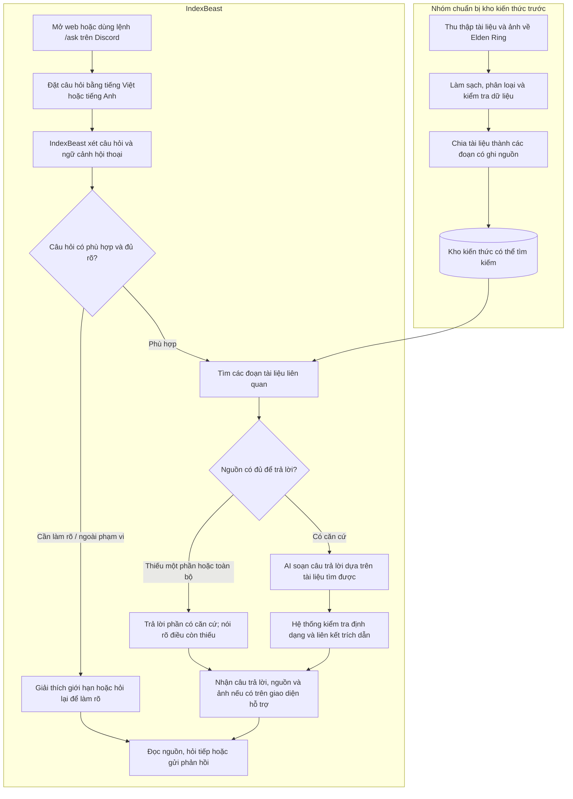
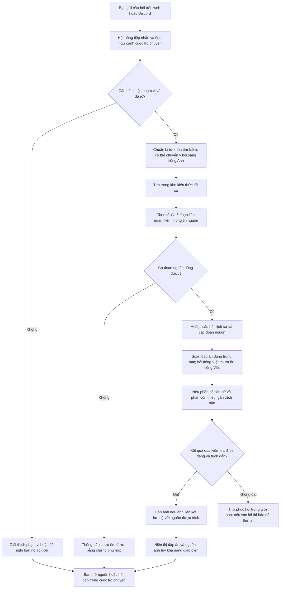
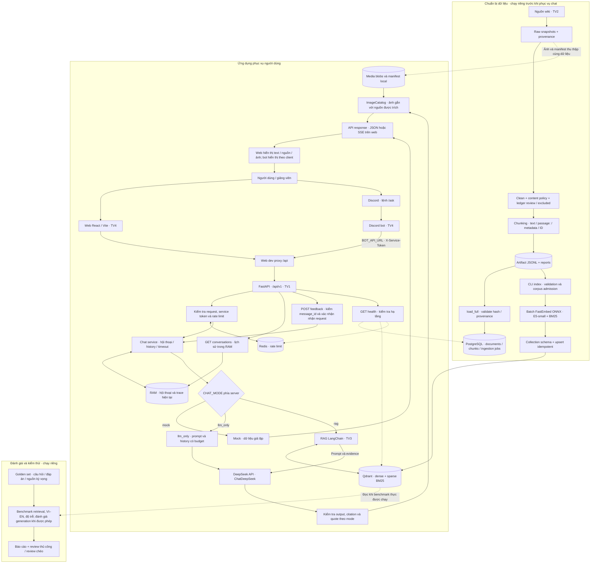
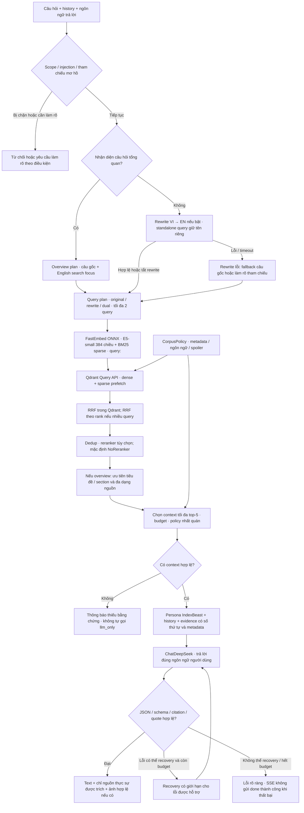
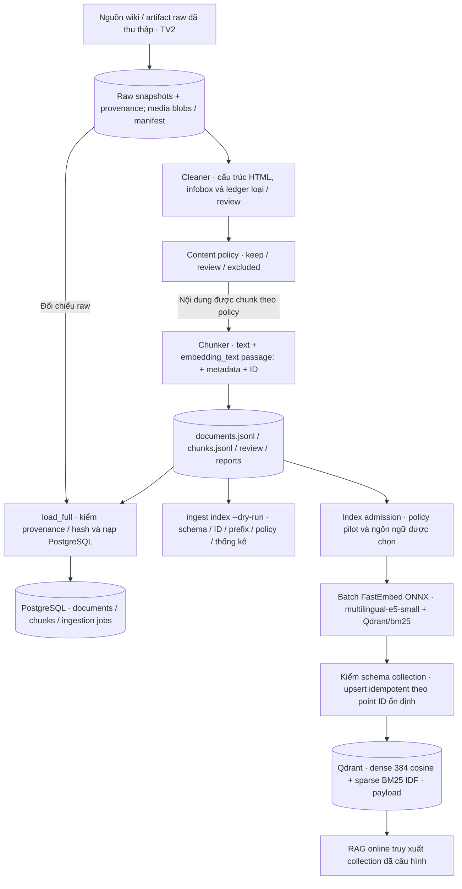

# Pipeline hệ thống IndexBeast

## A. Monkey

IndexBeast là trợ lý hỏi đáp về Elden Ring trên web hoặc Discord. Nhóm chuẩn bị kho tài liệu trước; khi bạn hỏi, hệ thống tìm những đoạn liên quan và dùng chúng để viết câu trả lời kèm nguồn.

Ví dụ: bạn hỏi “Cha mẹ Ranni là ai?”, hệ thống tìm đoạn nói về Ranni rồi soạn đáp án tiếng Việt kèm nguồn. Với câu hỏi về chỉ số chưa có trong kho, hệ thống cần nói rõ phần chưa tìm được; không bảo đảm mọi câu hỏi gameplay đều có đáp án.

### A1. Luồng khi người dùng gửi một câu hỏi

Sơ đồ dưới đây đi theo một lượt hỏi đáp, sử dụng kho kiến thức đã được nhóm chuẩn bị trước.

Ví dụ với “Cha mẹ Ranni là ai?”: **nhận câu hỏi → tìm nguồn về gia đình Ranni → chọn đoạn liên quan → AI viết đáp án tiếng Việt → kiểm tra trích dẫn → trả đáp án kèm nguồn và ảnh nếu đủ điều kiện**. Nếu nguồn chỉ trả lời được một phần, IndexBeast cần nói rõ phần còn thiếu. Hệ thống không thu thập lại toàn bộ dữ liệu mỗi khi bạn hỏi.

## B. Ape

### B1. Kiến trúc toàn hệ thống: dữ liệu, ứng dụng và hạ tầng

- Sơ đồ kết nối trên dùng cách chạy dev chia sẻ qua LAN/Radmin: web bind `0.0.0.0:15173`, proxy tới API `127.0.0.1:18000`. Máy khác dùng IP thật của máy host. Bot cũng có thể gọi thẳng API nếu API được mở mạng riêng phù hợp.
- `CHAT_MODE` do server cấu hình. `llm_only` có thông báo chưa đối chiếu kho tri thức; RAG không tự chuyển sang mode này khi thiếu nguồn.
- Hội thoại live và trace hiện còn trong RAM, không phải lưu bền PostgreSQL. Redis phục vụ rate limit trong luồng này.
- Ảnh chỉ được gắn khi có association hợp lệ với nguồn đã trích. Backend cung cấp ảnh qua `/api/v1/images/{sha256}`; khả năng hiển thị phụ thuộc client. Không mặc định bot Discord đã gửi ảnh.
- PostgreSQL, Qdrant và Redis chạy qua Docker Compose; web, API và bot chạy bằng các target Makefile trong cấu hình dev hiện tại. DeepSeek là dịch vụ API bên ngoài, model embedding chạy local qua FastEmbed ONNX.
- Các mũi tên liền mô tả luồng xử lý/dữ liệu; mũi tên nét đứt mô tả quan hệ hỗ trợ hoặc kiểm tra. Pipeline dữ liệu và benchmark không tự chạy mỗi lần người dùng hỏi.
- `GET conversations` đọc history live từ RAM. Route feedback hiện kiểm message tồn tại và trả `204`, **chưa lưu đánh giá bền**. Không vẽ PostgreSQL như nơi đã lưu toàn bộ hội thoại/feedback.
- Khối đánh giá biểu diễn công cụ và quy trình riêng, không có nghĩa đã đo đủ recall hay hoàn thành review chéo. Admin API hiện còn là khung; crawler Fanapis/entities cũng chưa phải luồng dữ liệu hoàn chỉnh, nên không vẽ như thành phần đã vận hành.

### B2. Chi tiết pipeline RAG khi nhận câu hỏi

Ngôn ngữ truy xuất tách khỏi ngôn ngữ trả lời: hỏi tiếng Việt có thể tìm bằng tiếng Anh nhưng vẫn trả lời tiếng Việt. Rewrite phụ thuộc cấu hình, không mặc định mọi request đều gọi rewrite. Overview bỏ qua rewrite LLM và dùng query plan xác định bằng code.

Context giữ metadata nguồn, release và giá trị `unknown`; không suy hai nguồn thành cùng canon. Kiểm tra citation/quote là kiểm tra cấu trúc và liên kết evidence, **không phải chứng minh entailment**. Có context chưa đồng nghĩa có đủ đáp án: generator vẫn có thể báo thiếu bằng chứng. Lỗi retrieval/provider được báo riêng, không coi như không có dữ liệu.

### B3. Chi tiết chuẩn bị dữ liệu và indexing

`--dry-run` chỉ validation, không tạo model/client hoặc ghi vector. Nạp PostgreSQL và index Qdrant là hai đường riêng từ artifact; không vẽ PostgreSQL thành bước bắt buộc của mỗi truy vấn chat.

## Mã nguồn và tài liệu đối chiếu

- [RAG pipeline](../backend/app/rag/pipeline.py), [generator](../backend/app/rag/generator.py), [Qdrant store](../backend/core/vector/store.py).
- [Chat service](../backend/app/services/chat.py), [Makefile](../Makefile), [hướng dẫn RAG](../backend/app/rag/README.md).
- [History API](../backend/app/api/routes/conversations.py), [feedback API](../backend/app/api/routes/feedback.py).
- [TV1 sửa cleaner](handover/2026-10-31_s2-tv1_sua-cleaner-bang-chi-so-infobox.md), [TV1 setup và hiện trạng corpus](handover/2026-11-01_s3-tv1_techstack-rag-va-setup-may-tv1.md).
