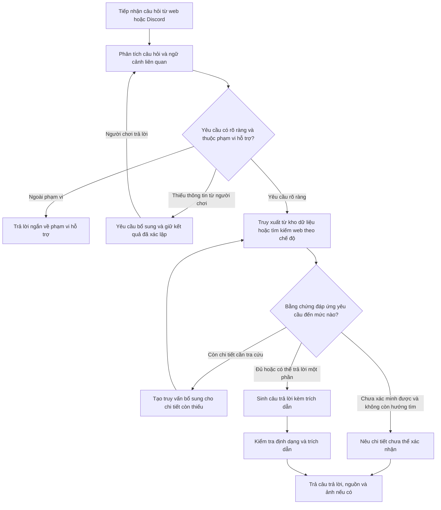
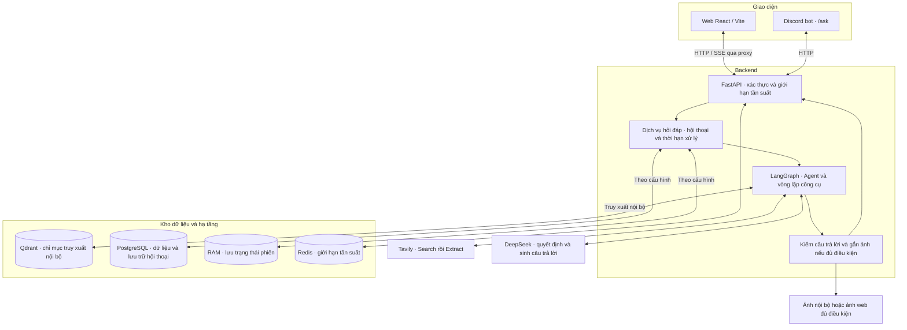
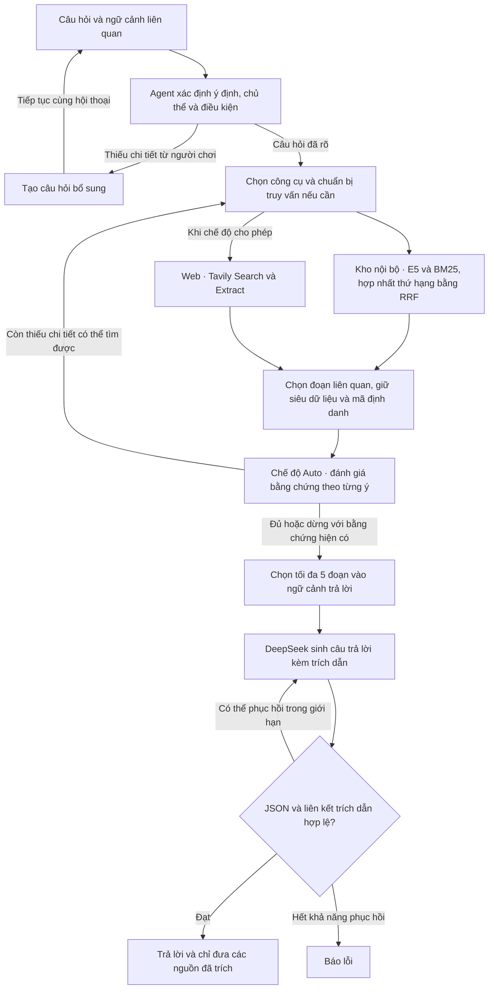
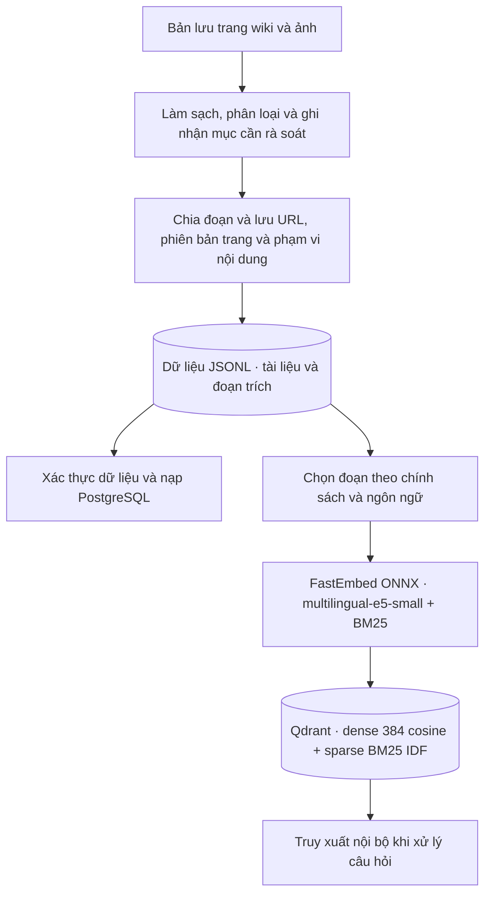

# Kiến trúc và quy trình xử lý của IndexBeast

IndexBeast là hệ thống hỏi đáp song ngữ Việt–Anh do nhóm 4 Hollows phát triển trong học phần Xử lý ngôn ngữ tự nhiên. Hệ thống hỗ trợ tra cứu cốt truyện, nhiệm vụ, tuyến đường, cơ chế trò chơi và cách xây dựng nhân vật trong Elden Ring. Phương pháp sử dụng là sinh câu trả lời tăng cường bằng truy xuất (RAG), kết hợp tác tử AI (Agent) để lựa chọn công cụ và đánh giá bằng chứng.

## A. Quy trình hỏi đáp

### A1. Một lượt hỏi đáp

1. **Tiếp nhận yêu cầu.** Agent xác định ý định, chủ thể và điều kiện người dùng nêu. Với yêu cầu nhiều mục tiêu, Agent có thể lập kế hoạch và giữ kết quả đã xác lập khi cần hỏi bổ sung.
2. **Truy xuất và đánh giá.** Ở chế độ Auto, Agent thường tìm trong kho nội bộ trước đối với dữ kiện ổn định. Agent có thể dùng Tavily để tìm bổ sung cho chi tiết còn thiếu. Một đoạn trích đủ rõ và đúng điều kiện có thể đáp ứng toàn bộ yêu cầu.
3. **Sinh và trả kết quả.** DeepSeek sinh câu trả lời theo ngôn ngữ đã xác định. Backend kiểm tra định dạng và liên kết trích dẫn trước khi gửi kết quả về giao diện.

### A2. Ví dụ minh họa

**Câu hỏi** “Green Turtle Talisman lấy ở đâu và cần vật phẩm gì để mở đường vào?”

| Agent cần xác định | Cách xử lý |
| --- | --- |
| Nơi lấy bùa | Tìm đoạn xác nhận đúng địa điểm. |
| Điều kiện mở đường | Nếu kho local chỉ có vị trí, dùng Tavily tìm riêng điều kiện mở đường vào. |
| Điều kiện dừng | Một đoạn trích đáng tin cậy có thể đủ nếu nêu rõ cả hai ý. Nếu chỉ xác minh được vị trí, hệ thống trả lời phần đó và nêu điều kiện mở đường còn bỏ ngỏ. |

Trong chế độ **Auto**, Tavily chỉ cần thiết cho ví dụ này khi bằng chứng nội bộ chưa bao phủ yêu cầu. Trích dẫn trên giao diện cho phép đối chiếu địa điểm và điều kiện mở đường với đoạn nguồn.

## B. Kiến trúc và triển khai

### B1. Kiến trúc toàn hệ thống

- Sơ đồ mô tả chế độ `rag` với Agent sử dụng công cụ. Máy chủ cũng có chế độ `mock` để giả lập và `llm_only` để gọi mô hình trực tiếp.
- Với `CHAT_PERSISTENCE=memory`, Agent có thể dùng tối đa hai tin nhắn gần nhất của người dùng làm ứng viên ngữ cảnh. Với `postgres`, hệ thống lưu hội thoại và phản hồi đánh giá trong PostgreSQL. Khi xác định được phạm vi bộ nhớ, Agent truy xuất ký ức liên quan từ một collection riêng trong Qdrant.
- API hỗ trợ JSON và truyền sự kiện qua SSE. Giao diện web dùng SSE để hiển thị câu trả lời trong khi hệ thống tiếp tục xử lý. Ảnh có thể đi kèm khi đáp ứng điều kiện liên kết với nguồn đã trích và thời hạn xử lý.

### B2. Agent và truy xuất bằng chứng

| Chế độ web | Khi nào dùng Tavily |
| --- | --- |
| **Off** | Truy xuất trong kho nội bộ. |
| **Auto** | Ưu tiên kho nội bộ với dữ kiện ổn định. Agent có thể tìm web để bổ sung bằng chứng quan trọng hoặc tra cứu thông tin mới. Discord sử dụng chế độ này. |
| **Always** | Tìm web trước khi hoàn tất câu trả lời về trò chơi. Agent có thể kết hợp bằng chứng từ kho nội bộ. |

- **Ngôn ngữ.** Agent có thể viết lại truy vấn sang tiếng Anh để khớp kho tiếng Anh, giữ tên riêng và điều kiện của người chơi. Câu trả lời vẫn dùng tiếng Việt hoặc tiếng Anh theo yêu cầu.
- **Nguồn web.** Tavily có thể trả về các domain ngoài danh sách ưu tiên. Trong các nguồn cộng đồng phù hợp ngang nhau, Agent ưu tiên Fextralife. Ghi chú chính thức được ưu tiên khi câu hỏi hỏi về thay đổi ở một patch cụ thể. Đoạn từ trang khác vẫn dùng được nếu hỗ trợ trực tiếp dữ kiện.
- **Đánh giá bằng chứng.** Trong Auto, Tool Agent có bước đánh giá riêng khi Tavily khả dụng và lượt hỏi cho phép nội dung tiết lộ tình tiết. Một nguồn có thể đủ nếu hỗ trợ trực tiếp các ý được hỏi. Khi có mâu thuẫn quan trọng, Agent có thể tìm thêm hoặc nêu rõ dữ kiện còn bỏ ngỏ. Tư vấn định tính có thể kết hợp kiến thức chung theo chính sách của hệ thống. Các thông số, dữ kiện cốt truyện, tuyến đường và bước nhiệm vụ cụ thể cần bằng chứng.
- **Kiểm tra đầu ra.** LangGraph điều phối các bước Agent lựa chọn. Backend áp dụng giới hạn xử lý và kiểm tra cấu trúc dữ liệu, phép tính phân bổ chỉ số và liên kết trích dẫn. Việc đối chiếu nguyên văn xác nhận câu trích có trong đoạn nguồn. Mức độ đoạn nguồn hỗ trợ kết luận được đánh giá riêng.

### B3. Chuẩn bị dữ liệu trước khi phục vụ chat

PostgreSQL và Qdrant được nạp từ cùng bộ dữ liệu JSONL theo hai luồng riêng. Mỗi điểm trong Qdrant có mã định danh ổn định để hỗ trợ nạp lại. Trong lần nạp bản `s4-wiki-release`, PostgreSQL lưu **4.164 tài liệu và 39.574 đoạn**, trong đó **34.070 đoạn tiếng Anh** được lập chỉ mục trong Qdrant. Kho chứa tài liệu về Elden Ring và Shadow of the Erdtree. Trường phạm vi phiên bản giữ giá trị `unknown` khi chưa có đủ căn cứ để phân loại.

## C. Phương pháp đánh giá

Nhóm xây dựng bộ câu hỏi đánh giá (golden set) gồm câu hỏi, đáp án tham chiếu và nguồn kỳ vọng. Kết quả được ghi theo bộ câu hỏi và phiên bản dữ liệu dùng trong từng lần chạy.

| Thành phần | Tiêu chí đánh giá |
| --- | --- |
| Truy xuất | Nguồn kỳ vọng có xuất hiện trong năm kết quả đầu hay không, và xuất hiện ở vị trí nào. |
| Sinh câu trả lời | Độ đúng so với đáp án tham chiếu và mức độ các dữ kiện trong câu trả lời được đoạn trích hỗ trợ. |
| Thời gian phản hồi | Độ trễ quan sát được trong điều kiện thử nghiệm đã ghi nhận. |

## Mã nguồn và tài liệu đối chiếu

- [Chuẩn bị request bằng LangGraph](../backend/app/rag/pipeline.py) · [Vòng lặp công cụ](../backend/app/rag/tool_agent.py) · [Prompt đánh giá bằng chứng](../backend/app/rag/prompts/assess.md).
- [Tavily](../backend/app/adapters/tavily.py) · [Truy xuất Qdrant](../backend/core/vector/store.py) · [Generator](../backend/app/rag/generator.py) · [Chat service](../backend/app/services/chat.py).
- [Golden set](../backend/eval/golden_set.jsonl) · [Handover dữ liệu S4](handover/2026-11-12_s4-tv2_wiki-quality.md) · [Handover Agent nhiều nguồn](handover/2026-11-14_s4-tv3_gameplay-multi-source.md).
