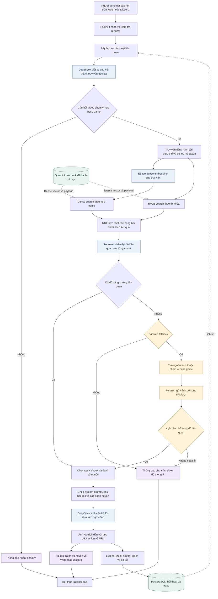

# Sơ đồ RAG của IndexBeast

**Nhóm:** 4 Hollows  
**Phạm vi:** lore Elden Ring base game  
**Luồng mô tả:** xử lý câu hỏi trên kho tri thức đã được đánh chỉ mục

Sơ đồ tập trung vào quá trình truy xuất và sinh câu trả lời. Qdrant đã có sẵn
vector, nội dung các đoạn văn và metadata nguồn. Đây là thiết kế dự kiến của
pipeline RAG; API thử DeepSeek hiện tại mới gọi model trực tiếp.

## Giải thích luồng xử lý

1. **Nhận câu hỏi:** Web và Discord dùng chung API. Backend lấy lịch sử cần thiết
   để hiểu các câu hỏi tiếp nối.
2. **Viết lại truy vấn:** DeepSeek chuyển câu hỏi thành truy vấn độc lập, xác định
   thực thể và ngôn ngữ. Tên riêng trong game được giữ để hỗ trợ tìm kiếm.
3. **Hybrid retrieval:** tìm kiếm ngữ nghĩa bằng embedding E5 và tìm kiếm từ khóa
   bằng BM25 trên Qdrant. Bộ lọc giới hạn nội dung ở `game_scope=base`.
4. **Hợp nhất và rerank:** RRF hợp nhất thứ hạng, sau đó reranker chọn các đoạn
   phù hợp hơn để đưa vào ngữ cảnh.
5. **Xử lý thiếu bằng chứng:** thử web fallback nếu được bật. Nhánh này chạy trong
   lúc trả lời và không tạo dataset mới. Nếu vẫn thiếu thông tin thì thông báo rõ.
6. **Sinh câu trả lời:** DeepSeek nhận câu hỏi gốc và các đoạn nguồn có đánh số.
   Câu trả lời giữ ngôn ngữ người hỏi và gắn trích dẫn về nguồn tương ứng.
7. **Trả kết quả và lưu trace:** hiển thị câu trả lời, đồng thời lưu thông tin cần
   thiết để theo dõi chi phí, độ trễ và phân tích câu trả lời sai.

## Lưu ý khi triển khai

- Kích thước top K và ngưỡng đủ bằng chứng cần được hiệu chỉnh bằng bộ đánh giá.
- Trích dẫn hợp lệ không tự chứng minh đáp án đúng; cần kiểm tra độ đúng và mức bám nguồn.
- Web có thể nhận token qua SSE ngay khi model đang sinh. Sơ đồ thể hiện quan hệ
  nghiệp vụ; lưu bản ghi hoàn chỉnh khi kết thúc lượt trả lời.
- Thinking và non-thinking là lựa chọn của bước gọi DeepSeek, không thay thế retrieval.
- Nội dung từ kho tri thức và web là dữ liệu tham khảo, không phải chỉ dẫn hệ thống.

Đọc kèm: [kiến trúc dự án](04_ARCHITECTURE.md) và [techstack](01_TECHSTACK.md).
